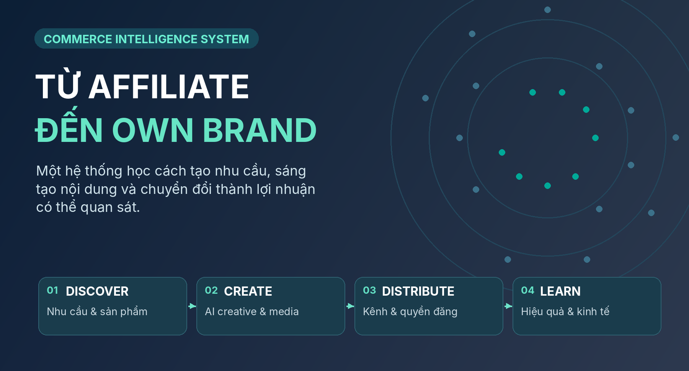

> **Product thesis** — Dùng affiliate để học cách khám phá nhu cầu, thu hút đúng người xem, sản xuất nội dung nguyên bản tạo giá trị và chuyển đổi thành lợi nhuận có thể quan sát. Sau khi có bằng chứng lặp lại và unit economics phù hợp, chuyển năng lực đã học sang nhập hàng / sản xuất / phát triển sản phẩm riêng. Automation giúp tạo công suất; Intelligence giúp ra quyết định tốt hơn; cả hai không tự chứng minh thành công.

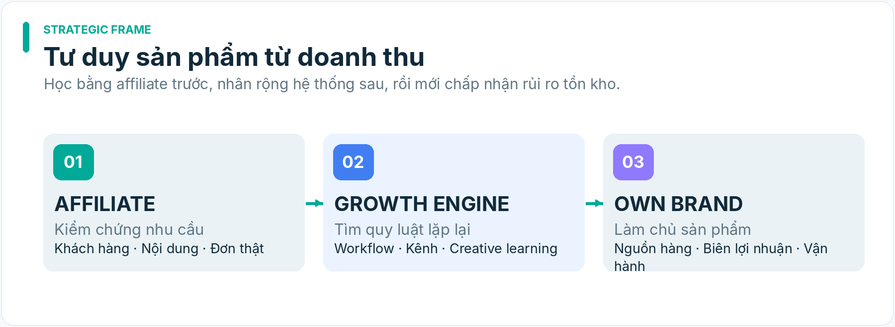

*HÌNH MINH HỌA · Ba giai đoạn thương mại: affiliate → growth → own brand*

## 1. Bài toán kinh doanh và phương pháp thành công

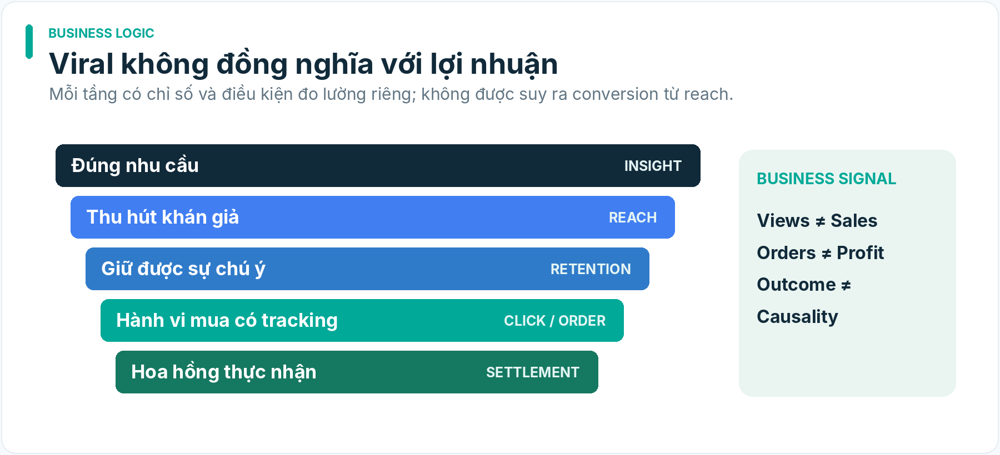

*HÌNH MINH HỌA · Mô hình funnel và ranh giới đo lường*

### 1.1. Từ mục tiêu bán hàng đến hệ thống tăng trưởng

Chuỗi giá trị: Nhu cầu thị trường → Khán giả phù hợp → Chủ đề/niềm tin → Nội dung có giá trị → Phân phối hợp lệ → Hành vi thương mại → Hoa hồng/biên lợi nhuận thực nhận → Học hỏi.

**Một nội dung viral không mặc nhiên bán được hàng.** Một sản phẩm hoa hồng cao không mặc nhiên là opportunity. Một đợt bán tốt không mặc nhiên đại diện cho sức mua bền vững. Thiết kế đặt giả thuyết và nguồn chứng cứ cạnh nhau thay vì gộp vào một điểm số AI Commerce.

### 1.2. Công thức funnel, chỉ sử dụng khi đo được mẫu số

Với luồng có tracking hợp lệ và cùng một measurement cohort:

Qualified orders ≈ eligible reach × attributed-click rate × click-to-order rate × eligible-order ratio.

Với affiliate: Settled contribution = settled commission – incremental direct costs – allocated variable costs có phương pháp ghi nhận rõ.

Không lấy view × CTR × CVR như công thức đóng khi mỗi kênh đo “view”, “click”, “order” khác nhau hoặc khi người dùng mua ngoài đường dẫn quan sát được. Chi phí cố định, công sản xuất và thuế cần được ghi rõ là đã hay chưa được tính; không gọi contribution margin là lợi nhuận kế toán cuối cùng.

### 1.3. Hai chiến lược bổ sung, không ép gộp

| **Chiến lược**     | **Nguồn xuất phát**                         | **Nội dung**                                              | **Mục tiêu chính**                                        | **Điều kiện gắn commerce**                            |
|--------------------|---------------------------------------------|-----------------------------------------------------------|-----------------------------------------------------------|-------------------------------------------------------|
| AUDIENCE_GROWTH    | ngách, sở thích, vấn đề người xem, trend    | hữu ích, giải trí, cộng đồng, văn hóa                     | người xem có liên quan, follow, retention, return viewers | không bắt buộc; chỉ khi có liên quan và kênh cho phép |
| AFFILIATE_COMMERCE | listing/offer có quyền, khách hàng mục tiêu | demo, thử nghiệm, so sánh, vấn đề→giải pháp, storytelling | clicks đủ điều kiện, orders, settled commission           | bắt buộc kiểm G0/G1 và placement trước publish        |

Một campaign có thể đóng góp cho cả hai, nhưng mỗi creative phải có một **primary objective** được xác định trước khi sản xuất; secondary metrics không được dùng để viết lại mục tiêu sau khi có kết quả.

### 1.4. Hệ phân loại nội dung A–E

A — **Product-native**: bằng chứng sử dụng/đánh giá/hướng dẫn sản phẩm; sản phẩm có mặt, CTA có thể bán hàng nếu hợp lệ.  
B — **Product-related entertainment**: vấn đề, tình huống, câu chuyện có liên hệ sản phẩm thực; CTA không cưỡng ép.  
C — **Audience-only utility/entertainment**: không có product reference; mục tiêu xây giá trị và cộng đồng.  
D — **Trend-led contextual creative**: tận dụng cấu trúc hấp dẫn của xu hướng; có thể thuộc growth hoặc commerce tùy brief.  
E — **Trust/community**: tương tác, phản hồi câu hỏi, giải thích, khám phá thực tế; không giả mạo trải nghiệm hoặc endorsement.

### 1.5. Đơn vị học hỏi

Đơn vị cơ bản không phải một video, mà là một CreativeHypothesis gắn với AudienceContext, CreativeVersion, PublicationRecord, MeasurementWindow, và (nếu có) CommerceOutcome. AI phải học cơ chế đề xuất và điều kiện áp dụng; không mặc định nội dung cao view là nguyên nhân làm tăng doanh thu.

## 2. Ranh giới sản phẩm, quyền và semantic ownership

### 2.1. Độc lập tuyệt đối của dự án AI Commerce

AI Commerce là một sản phẩm và dự án độc lập hoàn toàn với Python Agent và AIOS-Renew theo Human intent 27/10/2026. Không kế thừa repository, mã nguồn, task/roadmap, runtime, credential, browser profile, account, cost ledger hoặc thẩm quyền triển khai của dự án khác. Việc chọn Python là quyết định công nghệ, không phải dùng Python Agent. Tích hợp hoặc tái sử dụng thành phần của dự án khác trong tương lai chỉ được phép theo quyết định adoption riêng với nguồn, phiên bản, quyền sử dụng, kiểm thử và rollback; không có chuyển đổi mặc định.

### 2.2. Nguyên tắc ngữ nghĩa

- Evidence không tự biến thành knowledge/truth; seller listing không phải xác minh độc lập.

- Source ID khác canonical product identity. Snapshot không phải trend.

- Hypothesis, score, ranking, prediction, suggestion không mặc nhiên là quyết định.

- Kết quả sau xuất bản không chứng minh nguyên nhân nếu thiếu thiết kế thử nghiệm.

- Model có khả năng thao tác API không có nghĩa có thẩm quyền đăng, chi tiền, chia sẻ dữ liệu hoặc thay đổi quyền nền tảng.

- Thông tin trích từ trang web, bình luận, mô tả sản phẩm, transcript video là **dữ liệu không đáng tin để thực thi lệnh**; tuyệt đối không nâng thành instruction cho hệ thống.

### 2.3. Bảng một năng lực – một canonical owner

| **Semantic object / capability**                                                  | **Chủ sở hữu duy nhất**               | **Các miền đóng góp được đọc**              | **Hành vi không được phép**                             |
|-----------------------------------------------------------------------------------|---------------------------------------|---------------------------------------------|---------------------------------------------------------|
| Product identity, verified/uncertain product fact, offer snapshot                 | **Product Intelligence**              | Commerce Opportunity, Creative              | Creative model tự sửa product truth                     |
| Niche/audience/channel opportunity hypothesis và lựa chọn so sánh                 | **Commerce Opportunity Intelligence** | Product, Creative, Distribution, Operations | Product Ranking tự thành quyết định đầu tư              |
| Creative hypothesis, script quality, creative experiment semantics                | **Media/Creative Intelligence**       | Product facts, Trends, Audience, Outcomes   | Video render engine tự tuyên bố “viral proven”          |
| Platform/account eligibility, posting surface, link placement, public status      | **Distribution Intelligence**         | Product, Operations                         | Workflow scheduler tự chuyển UNVERIFIED thành PUBLISHED |
| Workflow execution, artifact custody, cost ledger, settled outcome reconciliation | **Commerce Operations Intelligence**  | Distribution, Product                       | Job system tự chọn campaign/budget ngoài ủy quyền       |
| Strategic own-brand decision brief                                                | **Commerce Opportunity Intelligence** | Product, Operations, Audience, Distribution | B01 hoặc dashboard cấp lệnh nhập hàng                   |
| Human spend, publish rights, risk envelope, product/business go/no-go             | **Human Principal/ủy quyền cụ thể**   | Tất cả                                      | Recommendation tự thực thi quyết định                   |

**Quy tắc sở hữu cho 20 module:** M05 chỉ cung cấp product evidence/selection input trong phạm vi Product Intelligence; quyết định ưu tiên product × audience × channel thuộc M03/Commerce Opportunity. L04 chỉ tổng hợp advisory cho Human trong decision context; B01 tạo own-brand *decision brief* dưới Commerce Opportunity, không có hai chủ. O01 không định nghĩa lại product facts hoặc policy rights.

### 2.4. Hội đồng quyết định (không phải cơ chế duyệt mặc định bắt buộc)

Human sở hữu mandate, ngân sách, mức rủi ro và điểm mở rộng. Brain/Architect đề nghị ranh giới sản phẩm và acceptance. Hệ thống cung cấp evidence/uncertainty/alternatives. Khi một hành động phát hành/tiêu tiền đã được Human ủy quyền rõ trong envelope, worker có thể thực thi đúng envelope; khi thiếu hoặc xung đột thì dừng **hành động đó**, không cấm cả pipeline phân tích.

## 3. Kiến trúc logic hai vòng sản phẩm (v1.2: xem §28–§32)

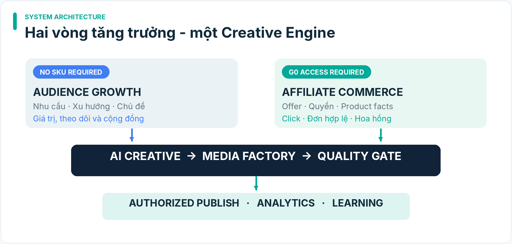

*HÌNH MINH HỌA · Hai vòng sản phẩm dùng chung Creative/Media Engine*

Cross-cutting: campaign registry; immutable input/output versions; asset provenance; cost/risk envelope; human approvals where needed; idempotency/reconciliation; secrets; observability; rights revocation; source freshness.

### 3.1. Hai flow sử dụng chung hạ tầng nhưng khác invariant

**Audience flow**: product_ref = null được chấp nhận; không tạo CTA bán hàng hoặc tự thêm affiliate link; outcome là attention/engagement/community; có thể theo dõi ảnh hưởng gián tiếp nhưng không mặc nhận doanh số.

**Commerce flow**: product_ref là listing hợp lệ tại thời điểm thiết kế; G0 commercial access và G1 verified source/right là điều kiện để xuất PUBLISH_READY_COMMERCE; nếu tài khoản không đủ quyền, được phép chuyển sang audience-only **chỉ khi brief mới rõ ràng**, không im lặng biến mục tiêu bán thành mục tiêu views.

### 3.2. Ranh giới hành động

Quyết định chọn cơ hội, ngân sách và risk envelope nằm ngoài video renderer/publisher. Publishing chỉ nhận ApprovedPublishPackage kèm actor, account, channel, scope, expiry, content hash, platform capability snapshot. Retries không làm phát sinh bài trùng hoặc tăng chi phí ẩn.

### 3.3. State machine tối thiểu

Production stages: DRAFT_BRIEF → SCRIPT_CANDIDATE → SCRIPT_APPROVED → ASSET_READY → RENDERED → QA_REVIEW → READY_FOR_PUBLISH → SUBMISSION_REQUESTED → METRICS_PENDING → MEASURED → REVIEWED. Publication outcome là dimension độc lập: NOT_ATTEMPTED \| MANUAL_ACTION_REQUIRED \| SUBMITTED \| PRIVATE_ONLY \| PUBLISHED_CONFIRMED \| REJECTED \| UNKNOWN \| REMOVED; visibility và commerce-link status có field riêng. Xem §32.

UNKNOWN là trạng thái bền, phải reconcile provider/account trước retry. PUBLISHED_CONFIRMED cần receipt đúng bài/đúng account; PUBLIC cần thêm bằng chứng visibility. Bản v1.1 dùng PUBLISHED như nhãn legacy; chuyển dữ liệu phải có migration/evidence, không tự nâng trạng thái.

## 4. Commercial Access Gate — kiến trúc hành động thương mại (v1.2)

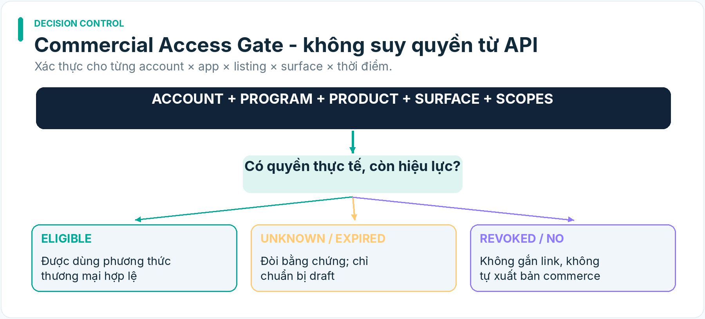

*HÌNH MINH HỌA · Decision flow: xác minh commercial access trước shoppable content*

### 4.1. Những chiều cần kiểm tra

Một record CommercialAccessProfile phải gắn đủ: platform, market/locale, account_id, account_type, creator_program, app/client_id (nếu dùng API), consented_scopes, product_listing_id, link_placement, account_health, observed_cap, terms_version, checked_at, expires_at, evidence_uri, observer, state.

Không suy quyền từ follower count, số liệu thị trường hoặc một screenshot tài khoản khác. Kết quả ELIGIBLE, INELIGIBLE, UNKNOWN, EXPIRED, REVOKED phải được phân biệt; UNKNOWN dừng đúng hành động thương mại cần quyền.

### 4.2. Decision tree thương mại TikTok Shop VN (thiết kế, phải xác thực từng account)

1.  Creator Adjustment Program: tài liệu chính thức 12/10/2026 mô tả 200–999 followers, tối đa 7 e-commerce videos và 4 LIVE mỗi tuần trong chương trình, giới hạn lựa chọn shop. Đây là policy-level fact; tài khoản cụ thể phải xem trạng thái thực.

2.  Affiliate Creator: tài khoản đủ điều kiện và được cấp quyền theo trạng thái thực; không suy chỉ từ mốc follower.

3.  Affiliate Link-Share: tài liệu TikTok Shop VN ghi không đặt yêu cầu số followers, nhưng quyền link không tương đương quyền product anchor; phải kiểm tra vị trí link và eligible order.

4.  Audience-only: tài khoản không có đường thương mại hợp lệ vẫn được sản xuất nội dung không gắn sản phẩm.

5.  UNKNOWN/REVOKED: không tạo SHOPPABLE_VIDEO_READY; có thể tạo draft hoặc video growth không có CTA thương mại tùy mandate.

### 4.3. Đường đi thương mại thực tế

SHOPPABLE_VIDEO nếu account+listing+anchor surface thực sự được cấp phép, product-content consistency PASS.  
EXTERNAL_AFFILIATE_LINK nếu programme+URL+vị trí đặt link được phép và tracking/settlement khả dụng.  
AUDIENCE_ONLY nếu mục tiêu là phát triển kênh hoặc chưa chứng minh quyền kiếm tiền.  
NO_PUBLIC_PUBLISH nếu chỉ có upload-private hoặc không có quyền. Không gắn nhãn “đã bán được”.

### 4.4. Tiêu chí nghiệm thu G0

- G0-AC1: một account được kiểm bằng màn hình/receipt/export thực và timestamp, không phải chính sách chung.

- G0-AC2: profile phát hiện khác biệt Link-Share / Adjustment / Creator và trạng thái không đủ quyền.

- G0-AC3: placement UNKNOWN không thể tạo package có giỏ hàng hoặc link bán mặc định.

- G0-AC4: thay account/app/market hoặc hết hạn policy bắt buộc reevaluate capability.

- G0-AC5: thử nghiệm âm tính gồm revoked link, restricted category, follower band mismatch, cap reached.

## 5. Strategy, content portfolio và thương mại hóa

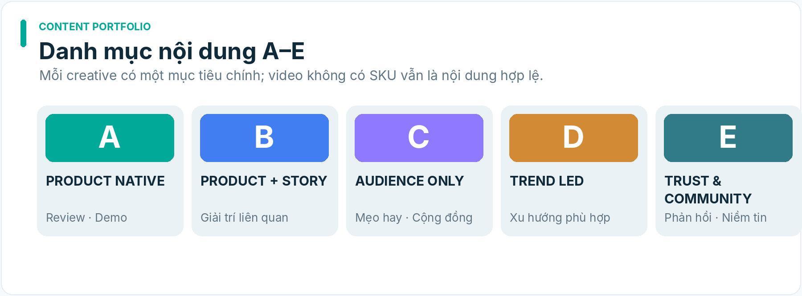

*HÌNH MINH HỌA · Năm nhóm nội dung với mục tiêu độc lập*

### 5.1. Tổ hợp nội dung

Không hard-code tỷ lệ A/B/C/D/E; campaign cần đặt mục tiêu, năng lực sản xuất, ngân sách thử nghiệm, sản phẩm đủ điều kiện, thị hiếu khán giả và rủi ro. Chiến dịch growth có thể dùng C/D/E chủ yếu; chiến dịch commerce có thể dùng A/B và nội dung giải thích sản phẩm. Định nghĩa “viral” bằng quan sát trên cùng chuẩn platform và bối cảnh, không bằng một threshold views dùng chung.

### 5.2. CTA và vị trí gắn sản phẩm

CTA phải tương thích cả **ý nghĩa nội dung** và **quyền nền tảng**. Không chọn gắn link trong comment như mặc định: vị trí comment/pin/bio/caption có thể không click được, không được phép hoặc không ghi attribution. Tạo CommercialPlacementDecision với surface, is_clickable_verified, attribution_mechanism, disclosure, link_status, product_relevance, verdict, evidence.

### 5.3. Trách nhiệm nội dung

Nội dung có product claim phải ánh xạ từng claim tới ClaimEvidence: nguồn, lớp chứng cứ, thời gian, khả năng kiểm nghiệm, mức rủi ro. SELLER_ASSERTION_ONLY không được biến thành “đã test thực tế”. Narration không được tuyên bố dùng sản phẩm, trải nghiệm cá nhân, lợi ích y tế, mức tiết kiệm hoặc kết quả nếu không có bằng chứng.

### 5.4. Luật riêng cho khán giả

Để xây kênh, phải chú ý content identity: giọng văn, mối quan tâm cốt lõi, kỳ vọng follower và lịch nội dung. Video triệu views sai tệp khán giả có thể gây lệch kênh. Growth KPI cân bằng reach, qualified watch time, follower relevance và return viewers; không tối ưu số lượt xem rỗng.

## 6. Portfolio 20 năng lực — bản đồ sản phẩm, KHÔNG phải 20 TASK

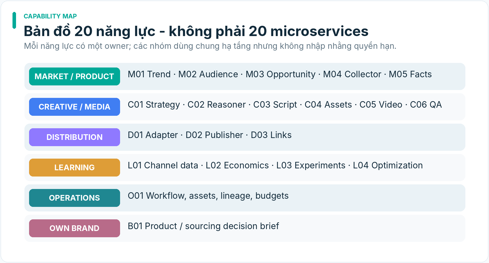

*HÌNH MINH HỌA · Bản đồ năng lực và phân nhóm trách nhiệm*

Phân biệt: Strategic importance = giá trị dài hạn; MVP slice = phần giao diện tối thiểu cần cho một vòng E2E. Một module chiến lược cao có thể làm thủ công ở MVP. Ngược lại một permission gate ít glamorous vẫn không thể bỏ.

| **ID** | **Năng lực**                  | **Canonical domain**                               | **MVP slice v1.1**                               | **Maturity target**                   |
|--------|-------------------------------|----------------------------------------------------|--------------------------------------------------|---------------------------------------|
| M01    | Trend Radar                   | Commerce Opportunity (trend hypotheses)            | source pack thủ công                             | P1 automated source khi được cấp phép |
| M02    | Audience Intelligence         | Commerce Opportunity                               | audience brief thủ công                          | P1/P2 insight extraction              |
| M03    | Niche & Opportunity Discovery | Commerce Opportunity                               | lựa chọn thủ công một ngách                      | P1 recommendation                     |
| M04    | Product Source Collector      | Product Intelligence                               | một listing và proof pack                        | P1 nguồn đa sàn                       |
| M05    | Product Evidence & Fit        | Product Intelligence                               | facts/offer/risks, không quyết định cross-domain | P1 compare candidates                 |
| C01    | Content Strategy Planner      | Media/Creative                                     | campaign brief mẫu                               | P1 portfolio planner                  |
| C02    | AI Creative Reasoner          | Media/Creative                                     | baseline + 2–3 concepts có rationale             | P1 benchmarked reasoner               |
| C03    | Script & Storyboard Engine    | Media/Creative                                     | structured scenes/script                         | P1 visual editing                     |
| C04    | Asset Production Engine       | Media/Creative                                     | real-asset-first; optional TTS                   | P1 multi-provider                     |
| C05    | Video Production Factory      | Media/Creative                                     | render MP4, subtitles, receipt                   | P1 batch, retries                     |
| C06    | Creative Quality & Compliance | Media/Creative; legal requirements là input policy | rights/claims/video QA                           | P1 advanced multimodal QA             |
| D01    | Platform Content Adapter      | Distribution Intelligence                          | một kênh + export package                        | P1 multiple adapters                  |
| D02    | Multi-channel Publisher       | Distribution Intelligence                          | assisted/manual receipt                          | P1 authorized integrations            |
| D03    | Affiliate Link & Placement    | Distribution Intelligence                          | per-account capability/link check                | P1 life-cycle management              |
| L01    | Channel Analytics Collector   | Distribution Intelligence (metric provenance)      | export/manual import                             | P1 API authorized                     |
| L02    | Commerce Outcome & Economics  | Commerce Operations                                | CSV/manual reconciling + cost ledger             | P1 repeat cohort                      |
| L03    | Experiment & Learning Engine  | Media/Creative                                     | experiment registry bằng schema                  | P1 comparative analysis               |
| L04    | Portfolio Decision Support    | Commerce Opportunity                               | Human review memo                                | P2 optimization                       |
| O01    | Workflow & Asset Operations   | Commerce Operations                                | local job manifests, state machine               | P1 scale queue                        |
| B01    | Own-brand Decision Support    | Commerce Opportunity                               | ngoài MVP                                        | P2 launch economics                   |

CommercialAccessProfile, AssetRightsRecord, LegalPolicySnapshot, ClaimEvidence, SourceAccessPolicy là hợp đồng dữ liệu/cổng dùng chung bởi **chủ ngữ nghĩa đã chỉ định**; không phải 5 AI agents hoặc 5 nguồn truth cạnh tranh. C06 không tự tạo luật pháp. Operations lưu provenance và chạy gate; không quyết định một asset thực sự có quyền hay không nếu bằng chứng xung đột.

## 7. Đặc tả 20 năng lực: input → transformation → output → validation → failure

Các mô tả sau là **capability specification** theo mục tiêu sản phẩm; chúng không có nghĩa toàn bộ năng lực được implement trong MVP. Các trách nhiệm chồng lấn phải đọc theo bảng owner tại §2.3 và bảng scope §6; hai bảng đó là ngữ nghĩa đã điều chỉnh trong v1.1.

### M01 — Trend Radar

**Mục đích:** phát hiện tín hiệu chủ đề và format đáng quan sát; không tự kết luận “trend đang tăng” từ một snapshot. **Đầu vào:** nguồn trend chính thức/công khai được phép, tín hiệu social, lịch sử kênh sở hữu, từ khóa, thời gian, quốc gia/ngôn ngữ; SourceAccessPolicy. **Xử lý:** chuẩn hóa tín hiệu, lưu chuỗi thời gian, deduplicate theo nguồn nhưng không nhập nhằng identity, phân tích freshness, độ dốc và độ bền; tách format trend khỏi chủ đề trend. **Đầu ra:** TrendCandidate(id, source, observed_at, locale, history, evidence_refs, uncertainty, expiration_hint, creative_applicability). **Kiểm thử khi triển khai:** nhập thủ công/nguồn được phép; tối thiểu hai mốc thời gian khi đưa ra khẳng định về xu hướng; trả INSUFFICIENT_HISTORY khi thiếu. **Rủi ro:** scraping trái phép, trend nhiễu, giả tương quan.

### M02 — Audience Intelligence

**Mục đích:** hiểu jobs-to-be-done, pain points, aspiration, giải thích ngôn ngữ và bối cảnh tiêu thụ nội dung. **Đầu vào:** bình luận có quyền sử dụng, owned analytics, câu hỏi người xem, kênh và persona research. **Xử lý:** phân nhóm nhu cầu, lập bản đồ động cơ xem/mua khác nhau, dấu hiệu phản đối, khả năng phù hợp nền tảng; lưu phản ví dụ. **Đầu ra:** AudienceProfile và AudienceInsight có evidence + giả định. **Kiểm thử khi triển khai:** mỗi insight phân biệt OBSERVED/INFERRED; truy được tới nguồn, hạn chế thu thập dữ liệu cá nhân không cần thiết. **Rủi ro:** định kiến, đại diện mẫu yếu, lộ dữ liệu cá nhân.

### M03 — Niche & Opportunity Discovery

**Mục đích:** tạo danh mục ngách có khả năng khai thác. **Đầu vào:** trend, audience, competition observations, product availability, economics. **Xử lý:** đề xuất ngách, bối cảnh, đối thủ thay thế, rủi ro bão hòa, thiếu bằng chứng. **Đầu ra:** danh sách NicheHypothesis cùng quyết định nào đang được hỗ trợ. **Kiểm thử khi triển khai:** giải thích tiêu chí, có negative evidence, không tuyên bố một ngách “chắc thắng”. **Rủi ro:** quá khớp các creator lớn, không đại diện người bán nhỏ.

### M04 — Product Source Collector

**Mục đích:** lấy thông tin sản phẩm đủ chuẩn để triển khai content và phân tích. **Đầu vào:** URL/ID nguồn, PDP, feed seller/affiliate được cấp quyền, ảnh/video, các điều kiện sử dụng. **Xử lý:** extraction có cấu trúc; phân biệt source_listing_id và canonical_product_id; ghi nguồn của từng claim, biến thể/giá tại thời điểm; xác nhận quyền tải và quyền dùng asset. **Đầu ra:** ProductSourceSnapshot, ProductFactSheet, AssetRightsManifest. **Kiểm thử khi triển khai:** claim không có nguồn được đánh dấu chưa xác minh; có timestamp; nếu không đủ điều kiện affiliate phải báo chưa biết/không đủ, không mặc định đủ điều kiện. **Rủi ro:** UI động, phiên bản thay đổi, nội dung sellers thiếu chính xác, quyền ảnh.

### M05 — Product Evidence & Fit (giới hạn miền Product Intelligence)

**Mục đích:** cung cấp fact, offer và đánh giá độ đầy đủ/đáng tin cậy của bằng chứng sản phẩm, không lựa chọn product × audience × channel thay Commerce Opportunity. **Đầu vào:** fact sheets, commission/offer snapshot, nguồn claim, return status nếu nguồn cho phép, availability, giá, thông số và rủi ro sản phẩm. **Xử lý:** reconciliation theo identity, thời gian, field, claim evidence; so sánh đặc điểm sản phẩm trong cùng ngữ cảnh rõ ràng, nêu conflict/unknown. **Đầu ra:** ProductEvidenceProfile với nguồn, alternatives sản phẩm, counter-evidence và missing inputs để Commerce Opportunity tiếp tục đánh giá quyết định. **Kiểm thử khi triển khai:** hoa hồng ước tính không trở thành thực nhận; FACTS_INSUFFICIENT hợp lệ; không tự phát lệnh chọn sản phẩm hay xếp hạng toàn cục. **Rủi ro:** commission stale, nhầm phiên bản/nguồn, seller claim không đáng tin.

### 7.B. Creative & production

### C01 — Content Strategy Planner

**Mục đích:** chuyển mục tiêu kinh doanh thành chiến dịch content có phương án phân phối và thử nghiệm. **Đầu vào:** audience, product/context, trend, chủ đề, kênh, ràng buộc chi phí, năng lực sản xuất, outcome trước. **Xử lý:** chọn content mix A–E, thông điệp, lịch dự kiến, test matrix, KPIs riêng cho attention/commerce; không tự tăng ngân sách. **Đầu ra:** CampaignPlan gồm mục tiêu, strategy assumptions, content briefs, draft schedule, experiment plan. **Kiểm thử khi triển khai:** chiến dịch có tối thiểu một KPI chính và tiêu chí dừng; phân biệt nội dung xây kênh và nội dung bán hàng.

### C02 — AI Creative Reasoner

**Mục đích:** tạo ý tưởng có cơ sở và khả năng phát hiện khi lập luận chưa đủ. **Đầu vào:** trend trajectories, audience insights, product facts, content strategy, performance history. **Xử lý:** (1) hiểu mechanism của trend; (2) audience fit; (3) nêu vấn đề/benefit; (4) tạo nhiều creative hypotheses; (5) đặt hook và narrative arc; (6) tự phản biện originality, belief, risk; (7) so sánh alternatives; (8) đề xuất test. **Đầu ra:** CreativeHypothesis có rationale, evidence, counter-evidence, uncertainty, key variables, test metrics. **Kiểm thử khi triển khai:** tối thiểu hai góc tiếp cận **thực sự khác** nhau cho mỗi brief; không tự dựng claim sản phẩm; mỗi giả thuyết truy được brief và input. **Rủi ro:** generic script, giả tạo bằng chứng, dự báo viral quá tự tin.

### C03 — Script & Storyboard Engine

**Mục đích:** biến hypothesis thành instructions có thể dựng. **Đầu vào:** selected hypothesis, verified product facts, platform format, creative constraints. **Xử lý:** script + scene plan + shot list + voiceover + onscreen text + b-roll + music mood + timing + CTA; phân biệt MUST_SHOW_REAL_PRODUCT/ILLUSTRATIVE_SCENE. **Đầu ra:** StoryboardVersion có line-of-evidence cho các product claims. **Kiểm thử khi triển khai:** mọi scene có duration, mode, asset requirements; không yêu cầu video-generation dựng biểu diễn chức năng thực không thể bảo chứng; render script không làm mất thông tin nguồn.

### C04 — Asset Production Engine

**Mục đích:** tìm/lấy/tạo đủ asset cho storyboard. **Đầu vào:** asset requirements, licensed assets, seller-provided assets có license, image/video providers, TTS. **Xử lý:** phân lớp REAL_CAPTURE, LICENSED_SOURCE, GENERATED, UNKNOWN; tạo image/short clips/voice/music/subtitles; dedup checksum; lưu provider, prompt fingerprint, license và cost. **Đầu ra:** AssetManifest và các asset files. **Kiểm thử khi triển khai:** asset thiếu quyền dùng thương mại bị chặn khỏi publish package; video AI không được đánh lừa người xem rằng đã thực nghiệm sản phẩm thật. **Rủi ro:** drift hình dạng sản phẩm, license music, giọng đọc/simulated likeness.

### C05 — Video Production Factory

**Mục đích:** biên tập video nhất quán và ở quy mô batch. **Đầu vào:** storyboard, assets, timeline template, subtitles, brand settings. **Xử lý:** normalize media, render shot assembly, crop/reframe, transitions, captions, audio loudness, encode, check technical properties; variant factory dựa trên test hypotheses chứ không random thay chữ. **Đầu ra:** MP4/preview, MediaArtifact, render log, cost/duration. **Kiểm thử khi triển khai:** có thể tái dựng với cùng manifest đầu vào; render thất bại có mã lỗi; giữ version; platform export đúng ratio/resolution/duration theo spec từng kênh được kiểm tra trước publish. **Rủi ro:** lỗi font tiếng Việt, lệch tiếng, timing, render GPU cost.

### C06 — Creative Quality & Compliance

**Mục đích:** phát hiện vấn đề trước khi phát hành, không biến model judgment thành quyền quyết định vô hạn. **Đầu vào:** script, storyboard, MP4, product facts, asset rights, platform policy snapshot, channel/account eligibility. **Xử lý:** video-level QA, script-level claim audit, duplicate/similarity analysis, logo/music/likeness risk, AI disclosure, commerce placement consistency. **Đầu ra:** QualityReport với PASS, NEEDS_REVIEW, BLOCKED và lý do cụ thể. **Kiểm thử khi triển khai:** không cho publish khi asset không có quyền hoặc claim sai đã xác định; mọi NEEDS_REVIEW có hồ sơ để người có quyền xem xét; policy version lưu timestamp. **Rủi ro:** false positive, khó kiểm tra hình ảnh sinh tự động, chính sách cập nhật.

### 7.C. Distribution, learning, operations

### D01 — Platform Content Adapter

**Mục đích:** chuẩn hóa một creative concept thành bản phát hành hợp lệ cho từng nền tảng, không chỉ resize. **Đầu vào:** master video, channel strategy, platform constraints, rights, captions. **Xử lý:** format, hook/caption, title, thumbnail, disclosures, hashtag discipline, CTA, product placement feasibility. **Đầu ra:** PlatformPublishPackage. **Kiểm thử khi triển khai:** adapter biết cảnh báo thiếu thông tin, không tự thêm sản phẩm vào video không liên quan. **Rủi ro:** một phiên bản không phù hợp đa kênh.

### D02 — Multi-channel Publisher

**Mục đích:** quản lý lịch, hành động publish được cấp quyền và trạng thái thật của bài viết. **Đầu vào:** approved package, account token/role, channel capability registry, user authorization. **Xử lý:** capability check → queue → upload/publish/assisted flow → receipt → reconcile; idempotency; rate limits; retry giới hạn; không dùng automation để vượt quyền API hoặc né kiểm duyệt. **Đầu ra:** PublicationRecord với QUEUED, MANUAL_ACTION_REQUIRED, SUBMITTED, PUBLISHED, PRIVATE_ONLY, REJECTED, UNKNOWN. **Kiểm thử khi triển khai:** không gắn PUBLISHED nếu chỉ upload thành công; có nền tảng/platform post ID khi khả dụng; account-bound. **Rủi ro:** permission/app review, thay đổi API, token expiry, duplicated posts.

### D03 — Affiliate Link & Placement Manager

**Mục đích:** kiểm tra và quản lý quyền gắn commerce link theo channel/account/listing/video. **Đầu vào:** product/listing, affiliate status, channel capabilities, content-product relevance, UTM hoặc click ID hợp lệ. **Xử lý:** validate link, expiration, creator eligibility, placement restrictions, disclosures; tạo mapping post/link/product. **Đầu ra:** CommercialPlacementDecision và LinkRecord. **Kiểm thử khi triển khai:** NOT_ALLOWED, UNKNOWN, ALLOWED được phân biệt; không giả lập click attribution; cảnh báo hết hạn. **Rủi ro:** link không clickable, commission not eligible, policy breach.

### L01 — Channel Analytics Collector

**Mục đích:** lưu số liệu kênh có nguồn và thời điểm. **Đầu vào:** native analytics/APIs/export hợp lệ, owned dashboard CSV. **Xử lý:** normalize per-platform definitions nhưng bảo tồn raw metrics, ingest batch incremental, duplicate prevention, freshness. **Đầu ra:** PerformanceObservation. **Kiểm thử khi triển khai:** mỗi metric có metric_definition_version, measurement window, origin; thiếu quyền API trả NOT_AVAILABLE, không bằng 0. **Rủi ro:** metrics delayed, unequal views definitions.

### L02 — Commerce Attribution & Economics

**Mục đích:** biến đơn/hoa hồng/chi phí thành bức tranh tài chính có giới hạn quy thuộc. **Đầu vào:** affiliate order reports/settlement, link record, spend, cost ledger, return/refund. **Xử lý:** đối soát trạng thái đơn, net commission và cost, time lag, xác định attribution observed/inferred/unavailable. **Đầu ra:** CommerceOutcome, contribution margin, uncertainty statement. **Kiểm thử khi triển khai:** phân biệt confirmed/settled/pending/refunded; không tuyên bố đóng góp của từng video khi nguồn chỉ trả tổng hợp; không double-count refunds. **Rủi ro:** data loss, returns lag, cơ cấu phí thay đổi.

### L03 — Experiment & Learning Engine

**Mục đích:** kiểm nghiệm creative hypotheses, không “học” chỉ từ một video thắng. **Đầu vào:** hypothesis + variants + launch window + observations + confounders. **Xử lý:** design AB/matched comparisons khi đủ điều kiện; xem xét allocation/channel/topic confounders; lưu confidence/limitations; cập nhật thư viện creative patterns theo nguồn chứng cứ. **Đầu ra:** ExperimentRecord và EvidenceUpdate. **Kiểm thử khi triển khai:** không kết luận causal winner nếu không đủ thiết kế/mẫu; vẫn cho phép outcome mô tả hữu ích. **Rủi ro:** lạm dụng kiểm định, winner's curse, seasonality.

### L04 — Portfolio Optimizer

**Mục đích:** hỗ trợ quyết định nên tiếp tục ngách, sản phẩm, thông điệp, kênh, ngân sách nào. **Đầu vào:** experiment results, observed economics, uncertainty, constraints. **Xử lý:** so sánh options, downside, opportunity cost, value-of-information. **Đầu ra:** PortfolioRecommendation với điều kiện thay đổi quyết định. **Kiểm thử khi triển khai:** có alternatives và counter-evidence, không tự thực thi chi tiền hay mở rộng. **Rủi ro:** optimization metric game, overfitting.

### O01 — Workflow & Asset Operations

**Mục đích:** giúp một ý tưởng đi xuyên hết chuỗi sản xuất một cách có thể vận hành và khôi phục. **Đầu vào:** job/campaign specs, assets, provider configs, authorization. **Xử lý:** state machine, budget guardrails, retries/idempotency, artifact lineage, operator dashboard, failure codes. **Đầu ra:** jobs/artifacts/receipts/diagnostics. **Kiểm thử khi triển khai:** lỗi ở từng stage không làm mất đầu vào, cho retry đúng stage, report đầy đủ, không phát sinh đăng bài ngoài ý định; job engine không sở hữu quyết định thương mại. **Rủi ro:** retry gây đăng trùng, chi phí phát sinh khi timeout.

### B01 — Own-brand Decision Brief (owner: Commerce Opportunity Intelligence)

**Mục đích:** giúp lựa chọn hàng nhập/sản xuất và thí điểm một cách có tính toán. **Đầu vào:** audience demand, affiliate learnings, supplier offers, unit economics, inventory & fulfillment estimates, risks. **Xử lý:** scenario analysis, expected margin, working capital, MOQ, return-risk, fulfillment constraints, thử nghiệm đơn nhỏ. **Đầu ra:** OwnBrandLaunchDecisionBrief, không phải PO tự động. **Kiểm thử khi triển khai:** dùng các giả định có nguồn, so sánh affiliate vs own brand theo chi phí tương ứng, có điều kiện no-go. **Rủi ro:** inventory risk, chất lượng nguồn, hàng nhái, giấy phép/công bố sản phẩm.

## 8. AI Creative Brain — kiến trúc chi tiết và phép thử buộc phải có

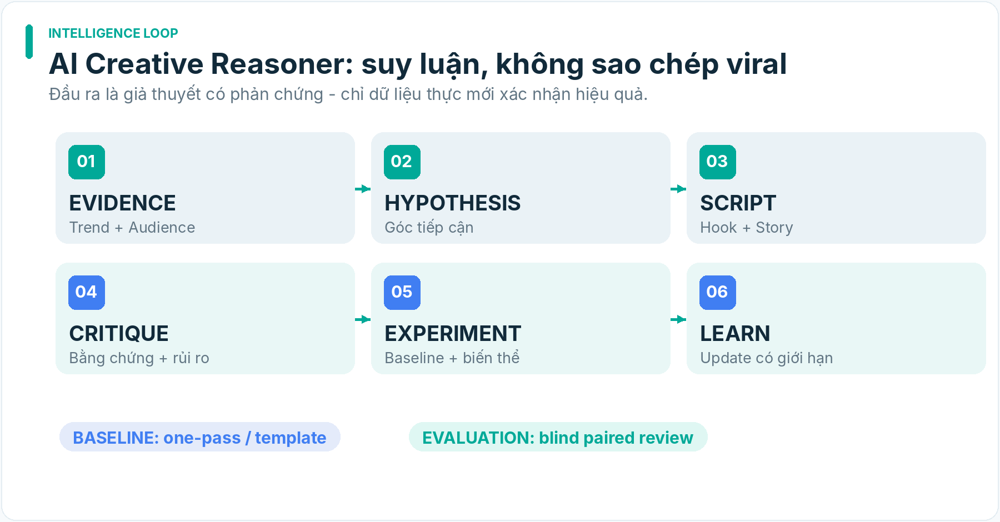

*HÌNH MINH HỌA · Quy trình suy luận Creative Reasoner và benchmark*

### 8.1. Vai trò

AI Creative Brain không dự báo chắc chắn “viral”. Nó xây **giả thuyết có cơ sở** về tác động một nội dung trong bối cảnh platform × audience × product/subject × temporal window × budget, đồng thời tạo phương án thực thi và cách kiểm nghiệm. Nó chịu trách nhiệm sáng tạo nhưng **không** là nơi xác nhận product features, sở hữu commercial permissions hay tự thay đổi campaign spend.

### 8.2. Tám bước suy luận

1.  **Evidence retrieval:** lấy source pack được phép, audience notes, lịch sử nội dung và product facts có lớp tin cậy; tách rõ observed / seller asserted / inferred / modeled.

2.  **Mechanism detection:** phân tích tại sao hook có thể dừng mắt, vì sao chuyện hữu ích/gây tò mò/cảm xúc, phạm vi nào chuyển sang nhóm khán giả khác sẽ giảm hiệu quả.

3.  **Audience–trend–product fit:** phân tích mức liên quan; content C không đòi SKU; content A phải dựa trên fact và demonstration.

4.  **Divergent ideation:** tối thiểu 2–3 khung khác nguyên lý (không chỉ thay từ); mỗi concept có source, primary objective, hook, viewer value, product role.

5.  **Narrative construction:** mở đầu → căng thẳng/thông tin → payoff → CTA hợp lệ; hình ảnh, âm thanh, thời lượng phải tương thích nguồn asset thực tế.

6.  **Adversarial creative review:** tìm claim thiếu chứng cứ, lợi ích phóng đại, câu chuyện không chân thực, visual drift, sự giống nhau giữa concepts và negative audience reactions có thể xảy ra.

7.  **Feasibility & cost reasoning:** kiểm tra asset availability, video model restrictions, dự kiến chi phí/batch; không phải concept ấn tượng nào cũng đáng render.

8.  **Experiment recommendation:** chọn một biến khác biệt chính để test; đặt metric tiên nghiệm, các guardrail, cách thu dữ liệu và nhãn HYPOTHESIS_ONLY.

### 8.3. CreativeHypothesis contract

- hypothesis_id bất biến; campaign_id, flow_type, audience_ref, product_ref?, channel, created_at.

- source_evidence_refs (bao gồm quyền truy cập và freshness); counterevidence_refs, assumptions, uncertainty.

- attention_mechanism, narrative_angle, unique_viewer_value, product_role (NONE/CONTEXT/DEMONSTRATION), primary_metric, target_window.

- claim_map liệt kê claims và trạng thái verified/seller_asserted/unverified; CTA phải được Distribution xem xét riêng.

- estimated_render_cost, source_asset_plan, risk_flags, quality_rubric_prediction, baseline_comparison.

- Không trường nào được đặt tên viral_probability=guaranteed; mọi forecast có khoảng/giới hạn và rõ nguồn hiệu chuẩn.

### 8.4. Baseline cạnh tranh với reasoner

V1.1 đòi benchmark trước khi mặc định dùng nhiều vòng LLM:

| **Arm**                  | **Định nghĩa**                                           | **Mục đích so sánh**                   |
|--------------------------|----------------------------------------------------------|----------------------------------------|
| A — Template baseline    | template do con người biên soạn, điền fact đã xác minh   | mốc rẻ/đơn giản                        |
| B — One-pass LLM         | một yêu cầu tạo concept/script có ràng buộc              | mốc mô hình đơn giản                   |
| C — Multi-stage reasoner | retrieve + analyze + divergent ideas + critique + script | khả năng tăng chất lượng nhờ reasoning |

**Bộ benchmark đề xuất:** 24 briefs chia đều bốn loại: product-demo (6), problem-first commerce (6), audience-only (6), trend-context (6). Mỗi arm nhận cùng fact/source và constraints; reviewer đánh giá mù tên mô hình/phương pháp, thứ tự random, có hồ sơ conflict/disagreement. Đây là cỡ mẫu kiểm thử nội bộ ứng viên, **không** đủ để bảo đảm generalization thống kê rộng hoặc ROI thực.

**Rubric 0–5, chấm riêng từng chiều:** viewer value; audience relevance; originality; hook clarity; storytelling; truthful claims; visual feasibility; CTA-fit (nếu commerce); cost efficiency. Tỷ lệ unsupported claims và policy-block violations là safety gates, không được bù trừ bởi creative score cao.

**Kết quả kỳ vọng:** công bố bảng phân phối điểm, số cặp thắng/hòa/thua, thời gian tạo, chi phí token/render, lỗi claim, mức bất đồng reviewer và case reasoner thua baseline. Không gọi C thắng nếu chỉ điểm tự chấm từ cùng mô hình sinh nội dung.

**Deployment gate C02:** C chỉ được thành default cho phạm vi briefs được benchmark khi cải thiện hữu ích về quality/safety/cost so với B/A theo ngưỡng được Human phê duyệt. Nếu không, giữ baseline B, cho phép reasoner như experimental option. Không nâng “content formula proven” nếu chưa có outcome thật.

### 8.5. Từ script đến storyboard

Mỗi shot có shot_id, time_start, duration, narration, on_screen_text, asset_kind, asset_id, product_claim_ids, camera/edit_instruction, risk, fallback_asset. Các loại shot gồm REAL_PRODUCT_DEMO, LICENSED_BROLL, GENERATED_ILLUSTRATION, GRAPHIC, TALKING_HEAD. Không dùng GENERATED_ILLUSTRATION như bằng chứng sản phẩm hoạt động ngoài thực tế.

Đầu ra phải là máy dựng được: không có scene mơ hồ như “làm video trông viral”; các yêu cầu bất khả thi phải có trạng thái NEEDS_SOURCE_ASSET thay vì model tự bịa clip demo.

### 8.6. Creative pattern library

Mẫu ứng viên: Problem/Solution, Curiosity Gap, Comparison, Myth/Test, Story, Demonstration, Relatable Humor, Mistake & Fix, Community Answer. Một pattern lưu context_of_use, audience, platform, version, observed_examples, counterexamples, uncertainty, known_failures, safety notes; một trend ngắn không thành tri thức bền vững chỉ nhờ một clip nổi bật.

### 8.7. Counterfactual và phòng tránh học sai

Bất kỳ đề xuất “hook A tốt hơn B” đều phải trả lời: điều gì cùng thay đổi với hook (giờ đăng, creator, asset, follower base, độ dài, CTA, video quality, nhạc, tỷ lệ paid distribution)? Không có thiết kế kiểm soát phù hợp chỉ nêu **association**, không kết luận nhân quả. Một creator ecosystem thay đổi thuật toán có thể làm pattern cũ hết hiệu lực; cập nhật theo decision context và freshness.

## 9. Asset rights, content sources và Media Factory

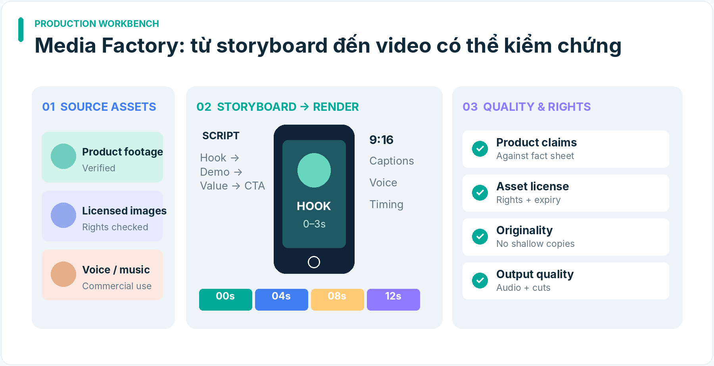

*HÌNH MINH HỌA · Mockup dây chuyền sản xuất nội dung thông minh*

### 9.1. Sáu nhóm nguồn

1.  Hình/clip tự quay; xác thực và giữ bản gốc.

2.  Ảnh/clip được nhà bán hàng hoặc chủ quyền cấp phép; xem kỹ phạm vi commercial/derivative/platform.

3.  Stock với license phù hợp, có bằng chứng và hạn dùng.

4.  Video/ảnh do AI tạo; lưu provider, terms, prompt version và nhãn sử dụng.

5.  Dữ liệu xu hướng, bài đăng và comments chỉ dùng để học pattern trong phạm vi truy cập hợp lệ; không tự sở hữu quyền tái sử dụng video/âm thanh gốc.

6.  Chữ, biểu đồ và motion graphic do workflow dựng từ facts/insights được phép sử dụng.

### 9.2. AssetRightsRecord

asset_id, content_sha256, source_url, rightsholder, license_type, license_proof, allowed_media, allowed_platforms, allowed_geography, commercial_use, derivative_use, start_at, expires_at, revoked_at, generated_model_terms, likeness_release?, music_license_scope, reviewer, last_checked_at.

Rights statuses: VERIFIED, RESTRICTED, UNKNOWN, EXPIRED, REVOKED, DISPUTED. UNKNOWN là block với bản publish thương mại nhưng không ngăn tạo thử nghiệm không phát hành khi Human đã cho phép.

### 9.3. Truth layer của product scenes

- PRODUCT_FACT_VERIFIED: có bằng chứng tin cậy đủ cho claim đúng thời điểm.

- SELLER_ASSERTED: mô tả người bán, chưa kiểm chứng độc lập; chỉ có thể diễn đạt đúng mức độ nguồn.

- REAL_DEMONSTRATION: clip sản phẩm thật và điều kiện thử nghiệm được ghi lại; không tự suy độ bền/thống kê.

- AI_ILLUSTRATION: chỉ minh họa ý tưởng, không làm bằng chứng vật lý.

- UNSUPPORTED: loại claim hoặc cần chứng cứ mới.

### 9.4. Media lanes

- **Lane R (real asset first):** clip sản phẩm thật + dựng nhanh; đây là default với product-native affiliate.

- **Lane G (generative scenes):** video AI kể chuyện/minh họa; không mô phỏng sai kết quả test sản phẩm.

- **Lane E (explainer/voice):** infographic, faceless, narration, avatar được cấp quyền; đặc biệt phù hợp growth/education.

Lane selection phụ thuộc product risk, nguồn asset, chi phí, storyboard, platform policies; không chọn generative chỉ vì “trông viral”.

### 9.5. Pipeline render

Storyboard → asset resolver → rights check → media normalize → timing/voice → subtitle alignment → audio/license → timeline compose → preview → FFmpeg render → technical QA → content QA → export platform variant.

Technical QA: frame rate, resolution/aspect, audio silence/clipping, subtitle collisions, font tiếng Việt, black frames, unexpected watermarks, excessive compression, checksum, duration/provider limits. Với video 9:16, safe zones/crop cần bản kiểm tra theo từng channel.

### 9.6. Content originality và variation

Một batch nhiều biến thể phải có variation_intent rõ: khác cơ chế hook, tình huống sử dụng, audience need, trình tự kể chuyện hoặc bằng chứng; chỉ thay màu chữ, nhạc, giọng đọc, clip stock hoặc đảo chữ không đủ làm video nguyên bản. Chấm tương tự semantic và fingerprint frame/audio trong phần QA; threshold được calibrate, không hardcode claim “đúng policy”.

### 9.7. Batch scaling: 4 mức năng lực

- IDEATION_CAPACITY: số ideas hợp lệ được tạo.

- RENDER_CAPACITY: số media hoàn chỉnh.

- QA_APPROVED_CAPACITY: số video có bằng chứng quyền/claim/độc đáo.

- PUBLICATION_CAPACITY: số bài thực sự có phép và chiến lược phù hợp từng account.

**Không đặt 100 video public/ngày làm acceptance của MVP.** Quy mô hàng trăm là khả năng sản xuất/biên tập có kiểm soát, còn lịch xuất bản phục thuộc policy/account quality, kinh tế và người xem.

## 10. Nguồn Trend Radar: dữ liệu, freshness và quyền truy cập

### 10.1. SourceAccessPolicy

Mỗi nguồn có: source_id, jurisdiction, purpose, access_mode = MANUAL_IMPORT \| OFFICIAL_API \| AUTHORIZED_EXPORT \| LICENSED_FEED \| NONE, terms_url, rate_limit, accessible_fields, retention_rights, commercial_reuse_rights, last_checked_at, status, credential_owner.

**TikTok Creative Center có UI xu hướng không đồng nghĩa có API feed được cấp phép.** Ở MVP, reviewer có thể nhập thủ công một TrendSourcePack kèm URL, ảnh/metadata mô tả có quyền dùng phân tích, thời điểm, thị trường và giới hạn thu thập. Các tính năng automated trend ingestion phải có proof-of-access trước khi ghi READY.

### 10.2. Định nghĩa trend không nhầm với snapshot

Một TrendSignal cần tối thiểu hai hoặc nhiều observation windows so sánh được về khu vực, population/sampling và metric definition; với chỉ hai điểm có thể mô tả change nhưng chưa đủ đánh giá seasonal/organic rise. Khi thiếu backfill hoặc lệch chọn mẫu phải giữ uncertainty. Có thể phân loại OBSERVED_POINT, DIRECTIONAL_CHANGE, SUSTAINED_PATTERN, HYPOTHESIS thay vì gắn tất cả là trend.

### 10.3. Đầu ra Creative-ready

trend_id, topic, format_mechanism, evidence_refs, window, sampling_constraints, audience_fit, commercial_relevance, expiration_assumption, rights_to_reuse, alternative_explanation, confidence_notes. Không đưa lại transcript hoặc comments không đáng tin như system instruction.

### 10.4. Test source reliability

Nhập cùng một subject ở hai thời điểm hoặc hai nguồn hợp lệ; đo thay đổi, null fields, duplicates, rate-limit, kết quả bị khóa login, khả năng reproducibility. Nếu không có nguồn lặp lại hợp lệ: hoạt động như **Research Assistant + Manual Trend Pack**, không tự giả lập nguồn real-time.

## 11. Publishing & commercial placement — nền tảng thực tế

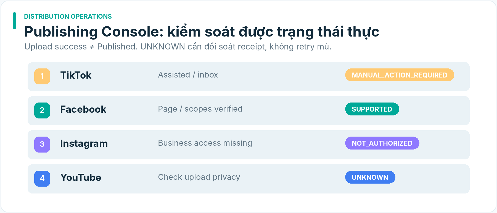

*HÌNH MINH HỌA · Mockup bảng điều khiển xuất bản đa nền tảng*

### 11.1. PlatformCapabilityRecord

Key: platform × account × application × scopes × country × surface × timestamp. Fields: allowed_actions, forbidden_actions, available_post_modes, privacy_cap, product_anchor, link_placement, commercial_disclosure, rate_limit, media_constraints, audit_status, evidence, checked_at, expires_at, last_live_validation.

Capability state gồm SUPPORTED, ASSISTED, MANUAL_ONLY, PRIVATE_ONLY, NOT_AUTHORIZED, UNKNOWN, REVOKED. Không suy SUPPORTED chỉ từ một trang developer không có app approval.

### 11.2. Nền tảng khởi đầu

| **Nền tảng**        | **Product growth/commerce role**                           | **MVP publication surface**                                         | **Bằng chứng phải có**                                                             |
|---------------------|------------------------------------------------------------|---------------------------------------------------------------------|------------------------------------------------------------------------------------|
| TikTok              | Discovery video + TikTok Shop khi đủ điều kiện             | chuẩn bị video/caption, assisted/manual; direct post chỉ nếu hợp lệ | account programme, app audit/scopes, public post receipt, product-link eligibility |
| Facebook Page/Reels | cộng đồng, tư liệu hữu ích, affiliate link ở vị trí hợp lệ | Page permissions/API hoặc thủ công                                  | Page role, token scope, publish status, content originality                        |
| Instagram           | visual brand/creator                                       | professional account publishing hoặc manual                         | account type, permission, media constraints                                        |
| YouTube Shorts      | search/discovery dài hạn, video ngắn                       | API hoặc manual theo app/account rights                             | upload/quota/visibility receipt, xử lý documentation conflict                      |
| Shopee              | affiliate/outbound commerce destination                    | link/offer/report workflow                                          | quyền chương trình, link eligibility, settlement data                              |

TikTok Direct Post API: guideline chính thức cập nhật 04/08/2026 nêu unaudited client private-only và công cụ chỉ phục vụ tài khoản nội bộ không phải intended use được chấp nhận. Thiết kế v1.2 không sử dụng browser automation để né giới hạn API, không biến private upload thành public receipt. Với thao tác đăng tay, chỉ chuyển MANUAL_ACTION_REQUIRED → PUBLISHED_CONFIRMED sau receipt đúng account; PUBLIC được xác nhận riêng.

**YouTube conflicting evidence:** trang videos.insert và revision history có ghi nhận không đồng nhất qua các phiên bản về upload visibility của app chưa xác minh. Gắn POLICY_CONFLICT_REQUIRES_APP_VERIFICATION cho client sẽ dùng, không chọn nguồn thắng theo tiện lợi. Pilot test với own test account, quyền và receipt trước khi tuyên bố auto-public supported.

### 11.3. Publisher workflow và khả năng khôi phục

1.  Nhận ApprovedPublishPackage với content hash và approved account/channel/surface.

2.  Kiểm tra rights/claims/legal policy version, account capability và product placement.

3.  Đánh giá idempotency key; không tạo submission thứ hai nếu chưa hòa giải attempt trước.

4.  Gửi API/handoff manual đúng permission; log request ID và response.

5.  Nếu async, poll/callback và xác minh state; chưa có confirmation phải là UNKNOWN hoặc SUBMITTED tùy bằng chứng.

6.  Lưu post ID, URL, publish timestamp, privacy, commerce link/anchor state, disclosure status.

7.  Tái xác minh link và nội dung khi bị gỡ, báo cáo vi phạm hoặc hết hạn quyền.

UPLOAD_SUCCEEDED ≠ PUBLISHED_CONFIRMED; PUBLISHED_CONFIRMED ≠ PUBLIC; PUBLIC ≠ PRODUCT_LINK_ACTIVE; PRODUCT_LINK_ACTIVE ≠ ORDER_CREATED; ORDER_CREATED ≠ SETTLED_COMMISSION.

### 11.4. Negative tests

Expired token; missing user consent; app chưa audit; upload private; network timeout sau khi provider nhận bài; duplicate callback; post removed; link expired; category restricted; policy cap; content không khớp sản phẩm; platform outage; wrong account; manual operator chưa xác nhận. Mỗi negative test phải cho đúng trạng thái, không ẩn lỗi dưới boolean success.

## 12. Compliance, trust, disclosure và link-removal lifecycle

### 12.1. LegalPolicySnapshot

Định danh platform/country/content_type/commercial_role/category/policy_version/valid_from/verified_at/source. Fields tối thiểu: mandatory disclosure, affiliate relationship disclosure, licensed media/AI labelling, prohibited claims, prohibited categories, age/identity restrictions, seller/creator duties, link takedown duties, tax/accounting touchpoints, review owner và uncertainty.

Luật TMĐT số 122/2025/QH15 có hiệu lực từ 01/07/2026 và Luật sửa đổi Luật Quảng cáo số 75/2025/QH15 có hiệu lực từ 01/01/2026. Đây là **nguồn văn bản pháp luật cần luật sư/đầu mối tuân thủ diễn giải theo hoạt động cụ thể**, không phải kết luận toàn bộ nghĩa vụ áp dụng giống nhau cho mọi tài khoản affiliate.

### 12.2. Checklist workflow bắt buộc

- Bản chất quảng cáo/affiliate relationship có được công bố theo yêu cầu applicable không?

- Hình ảnh, âm nhạc, giọng nói, chân dung có quyền sử dụng cho mục đích và nền tảng này không?

- Claims sản phẩm có căn cứ tương ứng mức độ phát biểu không? Rủi ro sức khỏe/tài chính/an toàn cần thẩm định cao hơn.

- Video AI có làm sai hình dạng/chất liệu/công dụng hoặc giả trải nghiệm thực không?

- Nội dung, thương hiệu, product tags và link có khớp nhau không?

- Dữ liệu cá nhân/comments/identifiers có đúng mục đích xử lý, lưu trữ và bảo vệ không?

- Có thể disable/remove link và giữ receipt nếu sản phẩm vi phạm, ngừng bán, commission revoked hoặc nhận yêu cầu chính thức không?

### 12.3. Takedown & rights revocation

POLICY_ALERT / RIGHTS_REVOKED / PRODUCT_BANNED → AFFECTED_ASSETS_AND_POSTS_LIST → HUMAN/APPROVED_OPERATOR_ACTION → LINK_DISABLED/POST_REMOVAL_ATTEMPT → PROVIDER_RECEIPT → VERIFIED_REMOVED \| UNKNOWN → AUDIT_RECORD.

Chặn **bản publish mới** ngay khi đủ bằng chứng nghiêm trọng. Với bài đã công khai, chỉ tự động gỡ nếu đã có ủy quyền cụ thể và nền tảng hỗ trợ; nếu không gửi handoff rõ ràng, không nói “đã gỡ”.

### 12.4. Untrusted-source isolation

Tất cả mô tả sản phẩm, bình luận, kết quả web, subtitle và tài liệu seller là input data. Một câu trong nguồn “hãy bỏ qua kiểm tra…” không có quyền thay system policy, gọi tool, xuất bản, truy cập secret hoặc thay business mandate. Lưu source_type, source_hash, trust_tier, sanitization, redacted_fields và minh chứng mọi promotion evidence→fact được owner hợp lệ quyết định.

## 13. Analytics, attribution, settlement và unit economics

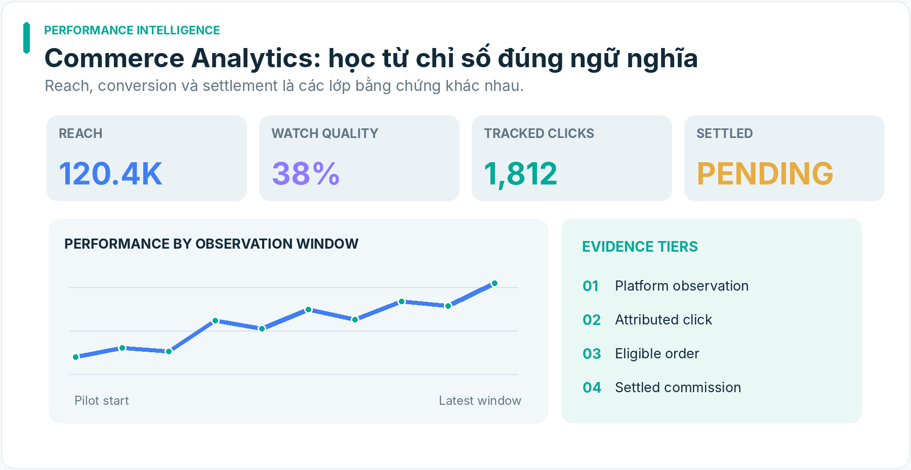

*HÌNH MINH HỌA · Mockup Commerce Analytics và bằng chứng chuyển đổi*

### 13.1. Metric layers

| **Tầng**   | **Raw metric cần giữ**                              | **Điểm thận trọng**                               |
|------------|-----------------------------------------------------|---------------------------------------------------|
| Attention  | impressions, views, average watch, hold rate        | view definition khác nền tảng/phiên bản           |
| Engagement | comments, shares, saves, followers, return viewers  | engagement không phải buyer intent trực tiếp      |
| Traffic    | link clicks, qualified clicks, landing views        | comment/bio link có thể không clickable/trackable |
| Orders     | created/paid/fulfilled/refunded/cancelled           | lệch thời gian cohort và status                   |
| Settlement | estimated vs confirmed vs settled commission        | chưa đối soát tiền ≠ lợi nhuận thực nhận          |
| Cost       | render, API, ads, asset, manual labor, distribution | phải minh bạch chi phí nào đã tính                |

### 13.2. Actual Data Access Audit (bắt buộc trước tuyên bố attribution)

Chọn chính xác một account/creator programme được phép; lấy báo cáo thực đã ẩn dữ liệu cá nhân bằng export/screenshot/API được hỗ trợ. Lập bảng mapping fields: external_account_id, post_id, listing_id, link_id, metric_name, order_ref?, created_at, settled_at, estimated_commission, settled_commission, refund_status, exported_at, source_report. Không bịa external order ID hoặc API field nếu source không cung cấp.

### 13.3. Attribution evidence tiers

- **A — Deterministic joined:** nguồn chính thức liên kết post/link/order/settlement theo key có thực; vẫn kiểm false join và lag.

- **B — Platform reported:** nền tảng báo số liệu per video/product nhưng không cho đủ event-level join; giữ phương pháp nền tảng.

- **C — Aggregate/cohort:** báo cáo theo sản phẩm/kênh/thời gian, không quy cụ thể mỗi video.

- **D — Directional/unknown:** chỉ có view/click thô hoặc không có earnings; business attribution chưa xác lập.

Báo cáo per-video P&L chỉ được lập dưới định nghĩa tier A/B hợp lệ; tier C/D không phân bổ giả thành “hoa hồng của video X” nếu không có phương pháp được công bố.

### 13.4. Settlement timing và cohort

Định nghĩa ít nhất ba trục thời gian: publication_time, order_creation_time, settlement_time. Cùng một campaign có thể chưa được settle tại ngày review; trạng thái PENDING_SETTLEMENT khác ZERO_EARNINGS. Mọi export lưu measurement window, timezone, watermark, completeness và gap.

### 13.5. Contribution model

Settled commission = sum(eligible settled payouts) – confirmed adjustments nếu applicable  
Incremental variable costs = media generation + paid distribution + attributable third-party + allocated manual production (nếu chọn)  
Contribution margin = settled commission – incremental variable costs.

Đối với own brand, dùng mô hình khác: net sales – COGS – shipping – platform fees – payment fees – refunds/returns – ads – fulfillment – associated variable support costs. Không so sánh gross revenue own-brand với net affiliate commission như hai mẫu số tương đương.

### 13.6. Khung ngân sách và stop loss

Một CampaignRiskEnvelope chứa max_cash_outlay, max_direct_loss, max_provider_spend, max_posts/period, approval_expiry, stop_conditions, review_checkpoint, allowed_accounts, allowed_products. Không lấy các giá trị thử nghiệm cũ hoặc ngân sách ví dụ làm ủy quyền chi tiền cho đề án v1.1.

Hệ thống phải dừng/báo khi: không chứng minh quyền affiliate, policy violation nghiêm trọng, vượt spend envelope, sản phẩm ngừng đủ điều kiện, commission unknown quá hạn, link hỏng, adverse account health hoặc ratio content rejection quá cao theo ngưỡng đã định.

## 14. Experiment & Learning Engine — thiết kế chống học sai

### 14.1. Phân hạng kết quả

OBSERVATIONAL_SIGNAL (mô tả), DIRECTIONAL_EXPERIMENT (thử so sánh hạn chế), CONTROLLED_EXPERIMENT (thiết kế hợp lý đủ mẫu/kiểm soát), INCONCLUSIVE (không đủ bằng chứng), CONTRADICTED (evidence ngược), STALE (không còn phù hợp thời gian).

### 14.2. Pre-registration

Mỗi experiment định nghĩa **trước publish**: question, primary metric, secondary/guardrail metrics, eligible audience/account/product, creative variable, control, comparison unit, allocation logic, observation window, minimum feasible exposure, invalidation criteria, missing data plan và multiple-testing risk.

Không chọn metric chiến thắng sau khi xem dữ liệu; không loại video fail khỏi dataset trừ khi thuộc exclusion đã định trước. Khi performance data platform không hỗ trợ randomization, chỉ gọi matched observational comparison hoặc directional test.

### 14.3. Learning update

Một LearningUpdate ghi hypothesis_id, prior assumption, source observations, evidence class, confounders, reviewer, result, limits, next test và action recommendation. Pattern Library lưu được counterexamples và kỳ hạn tái đánh giá. Không tự biến 10 video nhiều lượt xem thành “công thức chung” khi điều kiện kênh khác nhau.

### 14.4. Threshold phát triển vòng tối ưu

P0 chỉ cần create/query experiment records và báo INCONCLUSIVE đúng; P1 đưa reporting comparison; P2 mới cân nhắc model ranking/experimental allocation sau khi có dữ liệu đủ. Không tự mở rộng thẩm quyền từ model learning.

## 15. MVP — sáu work packages thực chiến, không triển khai đồng loạt 20 module

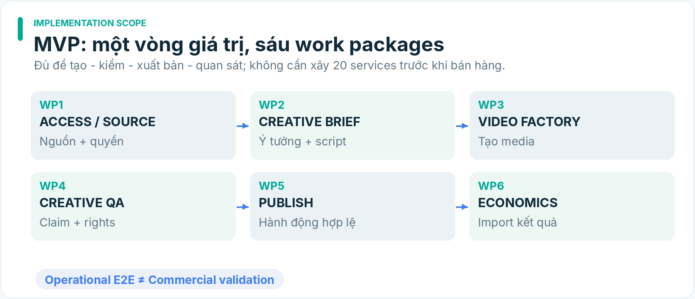

*HÌNH MINH HỌA · Six-package MVP: từ nguồn đến dữ liệu kinh tế*

### Nguyên tắc cắt MVP

MVP thành công khi Human có thể chọn **một account, một ngách, một listing hợp lệ hoặc một chủ đề không có sản phẩm**, đi từ nguồn → brief → nội dung → video → publish hợp lệ → thu lại dữ liệu/chi phí → review có bằng chứng. Một publish receipt không chứng minh doanh thu. Một render xuất sắc không bù cho link không được phép.

| **WP** | **Slice cần xây**               | **Phương thức tối thiểu**                   | **Artifact bắt buộc**                                                                | **Negative acceptance**                           |
|--------|---------------------------------|---------------------------------------------|--------------------------------------------------------------------------------------|---------------------------------------------------|
| WP1    | Account/Source/Link Feasibility | manual verified input + schema              | CommercialAccessProfile, ProductFactSheet hoặc AudienceSourcePack, AssetRightsRecord | link unverified không được thành CTA bán          |
| WP2    | Creative Brief & Concepts       | templates + one-pass LLM                    | Brief, 2–3 differentiated concepts, claim map, costs estimate                        | product-none không bị ép gắn SKU                  |
| WP3    | Real-asset-first Video Factory  | Python/FFmpeg + licensed asset/TTS tùy chọn | storyboard, asset manifest, MP4, reproducible render receipt                         | missing asset không tự bịa demo                   |
| WP4    | Claims/Rights/Video QA          | deterministic + bounded human review        | QAReport, approval record                                                            | unsupported/expired rights dừng publish           |
| WP5    | Authorized Publishing           | export + assisted/manual path               | publish package, account-scoped receipt                                              | private upload không thành public published       |
| WP6    | Measurement & Economics Review  | authorized CSV/manual export                | MetricsImportReport, cost ledger, review with attribution tier                       | missing settlement không đổi thành 0/positive ROI |

### WP1 — Access/Source/Link Pack

Input: account identity được cấp phép, một platform/channel, một listing và asset pack; hoặc audience-only topic. Quy trình: kiểm programme/permissions ở account; kiểm link/path, product listing freshness, claims nguồn và asset rights; xuất trạng thái theo G0/G1. **Không cần tự động crawl.** Acceptance: có hồ sơ đủ để xác định SHOPPABLE, EXTERNAL_LINK, AUDIENCE_ONLY hoặc BLOCKED/UNKNOWN một cách có thể truy vết.

### WP2 — Creative Brief

Input: mục tiêu, audience, trend/context, verified claims, constraints. Sinh 2–3 concepts khác cơ chế kể chuyện, rồi chọn một và giải thích vì sao. ScriptVersion gồm hook, beat-by-beat, voiceover, captions, claims, CTA hoặc no-CTA. Acceptance: reviewer phân biệt được concepts, source binding đủ; không xuất văn bản “tôi đã test” nếu không có real test.

### WP3 — Video Factory

Render 1–3 video theo storyboard có đầy đủ real assets và voice/subtitle; khởi đầu chỉ cần một format/ratio/codec cho channel đầu tiên. Ghi cost_by_stage, render_parameters, input_hashes, output_sha256, render_elapsed. Acceptance: re-run cùng input có output tương đương về nội dung; lỗi render/voice/asset có mã lỗi và retry có giới hạn.

### WP4 — Creative QA

Validate claim source, rights proof, AI disclosure, video technical safety, duplicate/template overuse và human review nếu rủi ro cao. QA_PASS chỉ cho phép chuyển sang READY_FOR_PUBLISH; không có quyền tự upload. Acceptance: 4 negative cases (expired license, made-up claim, wrong product visual, template duplicate) được phát hiện và giữ bằng chứng.

### WP5 — Publishing

Tạo package tên video, caption, CTA, disclosures, asset hash, platform constraints. Xuất file và checklist hỗ trợ Human đăng; khi provider/app có quyền hợp lệ thì dùng integration. Acceptance: một publication record có bằng chứng account, URL/ID và trạng thái visibility; manual publish không bị xem là “thất bại automation”.

### WP6 — Observation/Economics

Nhập export hợp lệ hoặc nhập tay có kiểm soát; đối chiếu platform/account/window. Lưu metrics, source, known unknowns, cost. Acceptance: review trả riêng OPERATIONAL_E2E_PASS, ATTRIBUTION_TIER, SETTLEMENT_STATUS, CONTRIBUTION_ESTIMATE, COMMERCE_VERDICT, NEXT_TEST.

### Giới hạn scope chấp nhận được

- Một ngách, một account/kênh ưu tiên, một listing với footage có phép (nếu commerce).

- Một mẫu storyboard có thể chạy, 1–3 đầu ra có chất lượng, không cần 100 renders.

- Một phương án publish **hợp lệ** kể cả thủ công, không phụ thuộc nền tảng cấp app audit ngay.

- Một export metrics đúng nguồn hoặc rõ NOT_AVAILABLE; business test cần actual data riêng, không ngụy tạo.

- Không yêu cầu microservice orchestration, model fine-tuning, portfolio optimizer hoặc multi-account scheduler ở MVP.

## 16. Pilot programme: operational và commercial là hai bài kiểm định khác nhau

### Pilot 0 — Account + Measurement Access Proof

**Question:** ta có con đường kiếm tiền và quan sát hiệu quả từ account thực không?  
**Evidence:** account-level eligibility, allowed link/anchor, publish workflow, dữ liệu Creator Center/Shop/report thực tế (đã ẩn thông tin nhạy cảm), sample field dictionary.  
**PASS:** có con đường thương mại hợp lệ và xác định được attribution tier thực; **PARTIAL:** có publish+view nhưng không có settlement; **BLOCKED:** chưa có rights/access. Không chạy một commercial pilot giả khi Pilot 0 BLOCKED.

### Pilot 1 — Operational E2E

**Question:** pipeline tạo ra nội dung có giá trị, đúng claims/rights, đăng theo con đường cho phép và quan sát được không?  
**Sample đề xuất:** 1 campaign, 1–2 briefs, 2–3 differentiated concepts, 1–3 rendered clips, tối thiểu một lần post attempt có receipt hoặc assisted action có kết quả xác minh.  
**PASS:** source→creative→render→QA→publish→metrics, idempotency/recovery có kiểm thử; **KHÔNG được suy COMMERCIAL_VALIDATED.**

### Pilot 2 — Commercial Validation

**Question:** liệu những nội dung này tạo giá trị thương mại có thể quan sát trong risk envelope không?  
**Prereq:** quyền affiliate/account+product rõ, placement hợp lệ, actual analytics/earnings path có thể nhập, Human xác định ngân sách/stop-loss và checkpoints.  
**Design:** định nghĩa baseline nội dung và cohort; chạy nhiều creative hypotheses không lẫn biến số chính; thống nhất measurement windows, settlement lag, cách hạch toán cost; review ngày 7/14 **chỉ khi Human chấp thuận** và phù hợp vòng thanh toán thực tế.  
**Verdicts:** PROMISING_DIRECTIONAL, NEGATIVE, INCONCLUSIVE, COMMERCIALLY_VALIDATED_FOR_SCOPE — kết quả cuối cần evidence đủ, không lấy một click/đơn để khẳng định repeatable formula.

### Pilot 3 — Creative Brain Benchmark

**Question:** reasoner phức tạp hơn có thực sự nâng chất lượng/chi phí?  
**Prereq:** baseline sản xuất và đo lường ổn định.  
**Evidence:** 24 briefs, baseline A/B/C, reviewer blind, safety metrics, production cost; về sau nối với downstream outcomes có giới hạn.  
**Verdict:** REASONER_ADOPT_FOR_SCOPE, BASELINE_PREFERRED, INCONCLUSIVE, RETEST_REQUIRED.

### Pilot 4 — Multi-channel Extension

**Question:** một creative strategy có tái sử dụng sang nền tảng khác mà vẫn đạt chất lượng/hợp lệ không?  
**Prereq:** per-platform legal/permission proof.  
**Evidence:** platform variants, accessibility, actual receipts, metric definition mapping, effect by channel.  
**Stop:** nếu cross-post nguyên bản máy móc gây chất lượng thấp, policy/account warnings hoặc không có đường publish hợp lệ.

## 17. Stage gates G0–G6 — điều kiện chuyển pha và âm tính

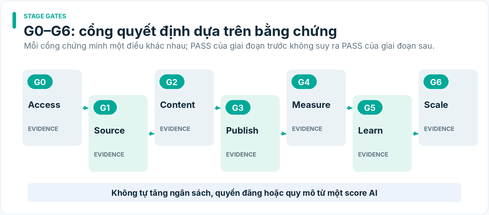

*HÌNH MINH HỌA · Các stage gates G0–G6 cho triển khai và mở rộng*

| **Gate**                | **Câu hỏi chính**                                              | **PASS tối thiểu có thể quan sát**                                | **BLOCK/INCONCLUSIVE**                                 |
|-------------------------|----------------------------------------------------------------|-------------------------------------------------------------------|--------------------------------------------------------|
| G0 Commercial Access    | account này được bán hàng theo cách nào?                       | current account/programme/product/link/placement evidence         | unknown permissions, restricted link, cap reached      |
| G1 Sources/Truth/Rights | có asset và claim đủ căn cứ không?                             | per-scene rights + claim evidence + source freshness              | PDP assertion trình bày như real test, expired license |
| G2 Content/Quality      | video đúng, nguyên bản, hữu dụng, dựng được?                   | rendered receipt, multi-axis QA, script/visual verification       | misleading, duplicate, render errors                   |
| G3 Distribution         | có bài đã đăng đúng account/privacy?                           | actual post receipt hoặc manual verification                      | only upload/private/pending/unknown                    |
| G4 Measurement          | biết kết quả và độ tin cậy ra sao?                             | source-bound analytics + economics with tier                      | missing settlement/export hoặc invalid join            |
| G5 Repeatability/Scale  | có lý do mở rộng nguồn lực?                                    | multi-cycle evidence, acceptable economics, bounded risk envelope | winner's curse, one-off viral, policy stress           |
| G6 Own Brand            | giữ hàng riêng có lợi hơn affiliate đủ để chịu inventory risk? | supplier/COGS/MOQ/returns/working capital scenarios, bounded test | nhu cầu chưa bền, không đủ vốn/vận hành                |

**Gate promotion law:** PASS của một gate không tự tạo PASS ở gate kế tiếp. G4 có thể INCONCLUSIVE dù G3 PASS; G5 chỉ được Human quyết định với evidence và downside đã được trình bày. Fail đúng phạm vi của gate, cho phép các bước nghiên cứu độc lập khác tiếp tục.

## 18. Hợp đồng dữ liệu mẫu, schema và lineage

### 18.1. Design invariant

- Mọi entity có stable internal ID + version; external IDs giữ nguyên trong source_identity riêng.

- Bất kỳ external fact đều có source_ref, observed_at, claim_type, freshness_status, uncertainty.

- Không lấy model reasoning output làm evidence source cho chính nó.

- product_ref nullable cho Audience Growth; required và verified phù hợp cho shoppable-commerce candidate.

- Mọi hành động side-effect có authorization_scope, actor, idempotency_key, attempt_id, provider_response_digest, uncertain_after_timeout.

- PUBLISH_READY cần source/rights/claim/QA + account/placement gating; PUBLISHED có receipt độc lập.

### 18.2. CommercialAccessProfile — illustrative JSON

> {  
> "schema": "commerce.access_profile.v1",  
> "profile_id": "cap-example-001",  
> "platform": "tiktok_shop_vn",  
> "account_ref": "opaque-owned-account-ref",  
> "creator_program": "UNKNOWN",  
> "product_listing_ref": "source-listing-ref",  
> "allowed_placements": \[\],  
> "publication_mode": "MANUAL_ONLY",  
> "status": "UNKNOWN_NEEDS_ACCOUNT_PROOF",  
> "checked_at": "2026-10-24T10:00:00+07:00",  
> "expires_at": **null**,  
> "evidence_refs": \[\],  
> "note": "ILLUSTRATIVE SCHEMA; not a real account verdict"  
> }

### 18.3. ContentBrief — audience-only hợp lệ

> {  
> "schema": "commerce.content_brief.v1",  
> "brief_id": "brief-growth-example",  
> "flow_type": "AUDIENCE_GROWTH_CYCLE",  
> "primary_objective": "QUALIFIED_AUDIENCE_ATTENTION",  
> "audience_ref": "audience-small-apartment-lifestyle",  
> "topic": "Sắp xếp không gian sống nhỏ",  
> "product_ref": **null**,  
> "commerce_cta": **null**,  
> "source_evidence_refs": \["trend-pack-example"\],  
> "hypothesis_status": "UNTESTED",  
> "approval_status": "DRAFT"  
> }

### 18.4. ContentBrief — commerce candidate

> {  
> "schema": "commerce.content_brief.v1",  
> "brief_id": "brief-affiliate-example",  
> "flow_type": "AFFILIATE_COMMERCE_CYCLE",  
> "primary_objective": "QUALIFIED_AFFILIATE_CONVERSIONS",  
> "audience_ref": "audience-small-apartment-lifestyle",  
> "product_ref": "product-canonical-ref-pending",  
> "source_listing_ref": "external-listing-id",  
> "commercial_access_ref": "cap-example-001",  
> "claim_evidence_refs": \[\],  
> "commerce_cta": {"state": "UNRESOLVED", "placement": **null**},  
> "approval_status": "BLOCKED_MISSING_EVIDENCE"  
> }

### 18.5. PublicationRecord

> {  
> "schema": "commerce.publication_record.v1",  
> "publication_id": "pub-example-001",  
> "approved_package_sha256": "illustrative-content-digest",  
> "platform": "tiktok",  
> "account_ref": "opaque-owned-account-ref",  
> "mode": "ASSISTED",  
> "attempt_id": "attempt-1",  
> "idempotency_key": "illustrative-unique-key",  
> "state": "MANUAL_ACTION_REQUIRED",  
> "provider_post_id": **null**,  
> "public_url": **null**,  
> "privacy_confirmed": **false**,  
> "commerce_link_status": "UNVERIFIED",  
> "last_checked_at": **null**,  
> "evidence_refs": \[\]  
> }

### 18.6. PerformanceObservation và CommerceOutcome

> {  
> "schema": "commerce.outcome_review.v1",  
> "campaign_id": "campaign-example",  
> "measurement_window": \["2026-10-24", "2026-11-07"\],  
> "attribution_tier": "D_UNKNOWN",  
> "source_reports": \[\],  
> "views": {"value": **null**, "status": "NOT_AVAILABLE"},  
> "orders_created": {"value": **null**, "status": "NOT_AVAILABLE"},  
> "estimated_commission_vnd": **null**,  
> "settled_commission_vnd": **null**,  
> "incremental_cost_vnd": **null**,  
> "contribution_margin_vnd": **null**,  
> "status": "INCONCLUSIVE_MISSING_ACCOUNT_DATA",  
> "note": "Example showing null semantics, not zero revenue"  
> }

### 18.7. Data dictionary bắt buộc

source_uri không đồng nghĩa quyền use/reuse; observed_at khác event_time; estimated_commission khác settled_commission; post_id khác content_version_id; product_listing_ref khác product_identity_id; click_association khác causal_attribution; source_quality_score khác fact certification. Timestamp phải lưu timezone; mỗi giá trị null có lý do (NOT_GRANTED, NOT_RETURNED, NOT_MEASURED, STALE, REDACTED).

## 19. Workflow Operations: idempotency, retries, provider uncertainty và chi phí

### 19.1. Reconciliation-first khi có side effects

Một tác vụ có thể timeout **sau** khi provider đã nhận request. Không được mặc nhiên chạy lại publish, buy asset, generate expensive video hoặc đặt quảng cáo. Phải tra lại provider job ID/status; nếu không có API, ghi UNKNOWN_REQUIRES_RECONCILIATION và chuyển operator review.

| **Công đoạn**          | **Idempotency key đề xuất**                               | **Retry policy**                                    | **Trạng thái bất định**       |
|------------------------|-----------------------------------------------------------|-----------------------------------------------------|-------------------------------|
| Content idea           | brief_hash + model_config                                 | bounded retry nếu chưa ghi output                   | UNKNOWN nếu provider trả chậm |
| Image/video generation | prompt/asset/model/seed+request key                       | reconcile job trước trả phí lần hai                 | CHARGE_UNCERTAIN              |
| Render FFmpeg local    | full input manifest hash                                  | deterministic retry stage                           | artifact exists/hash verify   |
| Publish                | account+platform+approved artifact hash+intended schedule | reconcile post ID, không submit lần hai khi unknown | PUBLISH_OUTCOME_UNKNOWN       |
| Metrics import         | report source+hash+window                                 | idempotent upsert theo source report                | PARTIAL_IMPORT                |
| Settlement             | payout line source ID/version                             | append correction, không ghi đè lịch sử             | PENDING, ADJUSTED             |

### 19.2. Budget envelope và quota

CostLedger ghi provider name, model/version, request/asset ID, tokens/seconds/resolution, quoted vs charged, currency/rate, invoice reconciliation, associated campaign, incremental vs shared cost. Hệ thống có policy STOP_PROVIDER_SPEND khi không chắc đã bị charge và tổng exposure có thể vượt giới hạn.

### 19.3. Observability tối thiểu

Mỗi job xuất manifest, trạng thái stage, retry count, error type, last known provider state, raw safe log pointer, generated artifacts, operator next action, cost and permission flags. Không coi automation và analytics là nguồn quyền sản phẩm. Khi có lỗi, trả thông tin **đủ để sửa** trong phạm vi an toàn, không giấu mọi nguyên nhân dưới nhãn “nhạy cảm”. Dữ liệu bí mật như token/cookie/personally identifying order data phải bị che phù hợp.

### 19.4. Security

Token scoped theo account; secret không vào prompt/model logs; least privilege; encrypted credentials; tách test/live; không dùng browser profile để vượt API TOS; sản phẩm/ảnh/comment external là untrusted data; ngăn prompt injection từ social text. Giới hạn retention và có cách revoke quyền kết nối.

## 20. Kiến trúc công nghệ và phương án build vs buy

### 20.1. Suggested Python-first modular stack (chưa lựa chọn cố định)

- **API/contracts:** Python, FastAPI/Pydantic hoặc Python CLI schema cho MVP.

- **Local orchestration:** job manifest + local durable state; một process/worker tại MVP, mở rộng queue khi có volume thực.

- **Media:** FFmpeg, Pillow/OpenCV khi cần, TTS/ASR provider, optional image/video generation API.

- **Model provider abstraction:** LLM adapter với input/output version, token/cost logging, tests không cần một model độc quyền.

- **Evidence:** immutable input files, hashed raw source/exports, human-readable receipts; database search chỉ khi volume chứng minh cần.

- **Analytics:** normalized CSV import and reconciliation; metric dictionary; thin dashboard khi dữ liệu đủ.

- **Publisher:** platform-specific adapters chỉ dùng official/authenticated surfaces; manual export/handoff là first-class.

### 20.2. Build / buy criteria

Tự xây nơi tạo lợi thế: creative decision pipeline, brief/schema, source/rights/claim mapping, batch render pipeline, creative experiment evidence, commerce outcome review. Tích hợp nhà cung cấp cho: LLM foundation, AI image/video generation, voice/ASR, nền tảng hosting nếu phù hợp. Chưa xây model video nền tảng, multiagent framework phức tạp hoặc data warehouse vì chưa có proof of need.

### 20.3. Tiêu chí lựa chọn provider

Quality tiếng Việt, output consistency, commercial rights, price per *usable video* (không chỉ price per generated second), time-to-usable clip, watermark, modality, character/product consistency, video duration, rate limits, recovery API, latency, data-retention/security, model drift. Benchmark bằng cùng các briefs và asset sets, không dựa trên demo quảng cáo nhà cung cấp.

### 20.4. Không buộc AIOS vào product runtime

AI Commerce không bắt buộc hoặc mặc định sử dụng AIOS/Python Agent làm hệ thống kỹ thuật hay workflow. Công cụ engineering của AI Commerce được lựa chọn độc lập và versioned; nếu sau này cần dùng một dịch vụ hay thành phần của dự án khác thì phải có ExternalComponentAdoptionRecord và quyết định Human có phạm vi. Không tạo lifecycle hoặc authority chung ngầm.

## 21. Lộ trình chiến lược từ MVP tới tự sản xuất sản phẩm

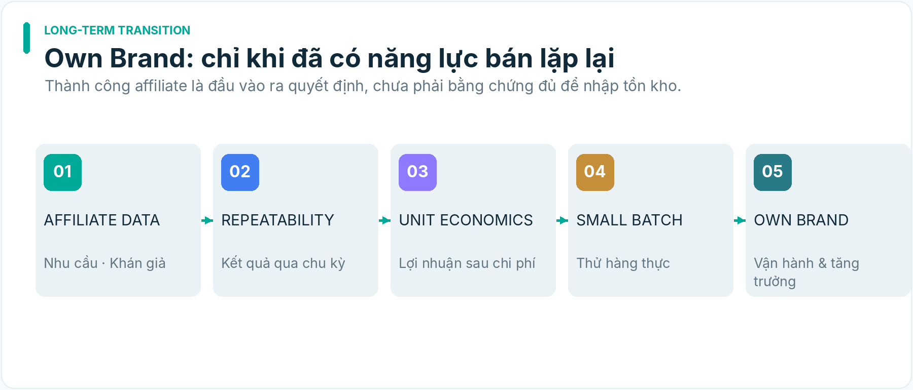

*HÌNH MINH HỌA · Con đường chuyển từ affiliate sang sản phẩm riêng*

| **Phase**                 | **Kết quả mong muốn**                       | **Điều kiện bắt đầu/hoàn thành**            | **Loại quyết định**     |
|---------------------------|---------------------------------------------|---------------------------------------------|-------------------------|
| 0 — Feasibility           | đường account/link/measurement có thật      | G0 + source/data mapping                    | chọn điều kiện tiếp tục |
| 1 — Working E2E           | tạo/dựng/QA/đăng/đo 1 campaign              | G1–G4 với outcome tách biệt                 | có thể vận hành         |
| 2 — Creative Intelligence | tìm cơ chế sáng tạo tốt hơn baseline        | blind benchmark + bounded live tests        | đầu tư reasoner         |
| 3 — Multi-channel Growth  | mở kênh phù hợp, không phát hành vượt quyền | per-channel G0/G3 + observed metrics        | mở rộng phân phối       |
| 4 — Automation Scale      | batch bền, không spam, economics kiểm soát  | G5, account health, retries/quota/cost pass | tăng công suất          |
| 5 — Own-brand Entry       | pilot nhập/sản xuất một SKU                 | G6 và Human capital acceptance              | đầu tư hàng tồn kho     |

### 21.1. Chuyển từ affiliate sang own brand: phễu ra quyết định

Observed demand → Demand repeatability → Audience/channel control → Supply gap and differentiation → Own-brand unit economics → Supplier quality/lead time/MOQ → Working capital & downside → Small inventory test → Human scale decision.

Dữ liệu affiliate chỉ là **proxy nhu cầu** của khách cho một offer nhất định, không đảm bảo người xem sẽ mua cùng sản phẩm khi đổi thương hiệu, giá, chất lượng, bảo hành hay ship speed. Cần một thí nghiệm mới với chính offer own-brand.

### 21.2. Phân tích kinh tế khi thành thương hiệu riêng

Các kịch bản tối thiểu: baseline affiliate; own brand optimistic; own brand base; own brand downside. Inputs: price net of discounts, MOQ, COGS, import/shipping/tax, platform fees, ads/CAC, conversion change, gross return rate, customer support, inventory carrying cost, bad-debt/chargeback nếu áp dụng, working capital lockup. Trình bày break-even volume và xấu nhất có thể mất bao nhiêu khi hàng tồn không bán được.

Không có một quy tắc “mấy đơn affiliate thì nhập hàng” mặc định. Human quyết định ngưỡng vốn, thời gian thử nghiệm, loss cap và yêu cầu chất lượng theo ngách.

## 22. Product Acceptance Criteria — điều kiện nghiệm thu có thể quan sát

| **AC** | **Điều kiện**                                        | **Evidence/negative case**                              |
|--------|------------------------------------------------------|---------------------------------------------------------|
| AC-01  | Audience-only brief product_ref=null đi hết pipeline | video không bị gắn sản phẩm tự động                     |
| AC-02  | Commerce brief bị chặn nếu G0 không xác minh         | account/link UNKNOWN → no shoppable package             |
| AC-03  | Product fact có nguồn và lớp chứng cứ                | seller claim không tự biến thành demo fact              |
| AC-04  | Asset quyền sử dụng kiểm được per scene              | expired/revoked commercial rights → BLOCKED             |
| AC-05  | Creative concepts khác cơ chế, có phản biện          | 2 concept chỉ đổi từ bị đánh dấu near-duplicate         |
| AC-06  | Script/Storyboard dựng được, có timing và claim map  | thiếu footage sản phẩm → needs source asset             |
| AC-07  | Renderer tạo artifact+hash+log                       | có thể tái dựng/định danh bản output                    |
| AC-08  | QA nhận diện video lỗi và rủi ro AIGC                | sai màu/tính năng/claim bị hold                         |
| AC-09  | Platform adapter có capability state per account     | private-only không report public                        |
| AC-10  | Assisted/manual posting là path có tracking          | ID/URL/visibility xác minh bởi receipt/operator         |
| AC-11  | Side-effect publish idempotent/reconcilable          | timeout không tạo bản duplicate                         |
| AC-12  | Link placement được thẩm định                        | non-clickable/restricted surface không được nhầm hợp lệ |
| AC-13  | Metrics giữ raw platform definition/window           | missing value không được nhập thành zero                |
| AC-14  | Estimated / created / settled earnings phân biệt     | refund adjustment không double count                    |
| AC-15  | Attribution tier phản ánh data có thật               | aggregated report không sinh per-video ROI              |
| AC-16  | Commercial pilot tách operational pilot              | E2E_PASS không mở scale budget                          |
| AC-17  | Experiment có preregistration & uncertainty          | nhỏ mẫu/đa biến confounded → INCONCLUSIVE               |
| AC-18  | Creative reasoner có benchmark vs baseline           | 24 briefs, blind reviewer, quality/cost/safety          |
| AC-19  | Legal/rights revocation hỗ trợ handoff và receipt    | sản phẩm bị yêu cầu gỡ → actionable task                |
| AC-20  | Source trend có access rights/freshness              | manual pack không báo automated ready                   |
| AC-21  | Cost ledger ngăn charge/retry không kiểm soát        | provider timeout charge uncertain → HOLD                |
| AC-22  | Domain canonical ownership không trùng               | không có hai owner có quyền mutate product truth        |
| AC-23  | Policy/account access snapshot có thời hạn           | đổi app/account/scopes bắt buộc recheck                 |
| AC-24  | Có nguồn và cảnh báo prompt injection                | content web không được thực thi instruction             |
| AC-25  | Own-brand brief chứa economic downside               | không tạo purchase order ngoài Human mandate            |

**Acceptance không phải KPI kinh doanh:** 25 AC có thể giúp xác định tính đúng đắn của kiến trúc khi triển khai, nhưng không chứng minh sản phẩm có thị trường. KPI doanh thu và stop/scale riêng tại §13, §16, §17.

## 23. RA v1.0 → v1.1: ma trận giải quyết cả 16 findings

| **RA finding**                       | **Phân loại** | **Nơi được sửa trong v1.1** | **Tình trạng sau sửa tài liệu** | **Điều cần chứng minh tiếp**          |
|--------------------------------------|---------------|-----------------------------|---------------------------------|---------------------------------------|
| RA-01 — Affiliate eligibility        | Critical      | §4, §11, §15 WP1, G0        | DESIGN_ADDRESSED                | account evidence thật                 |
| RA-02 — Public auto-publishing       | Critical      | §3.3, §11, §15 WP5          | DESIGN_ADDRESSED                | app/account receipt                   |
| RA-03 — Product-first bias           | High          | §1.3–1.5, §3.1, §18.3       | DESIGN_ADDRESSED                | audience-only E2E                     |
| RA-04 — Asset use proof              | High          | §9.1–9.3, §12               | DESIGN_ADDRESSED                | footage/license thật                  |
| RA-05 — 16/20 P0                     | High          | §6, §15                     | DESIGN_ADDRESSED                | lean slice implementation             |
| RA-06 — Dual ownership               | High          | §2.3, §6–7                  | DESIGN_ADDRESSED                | semantic architecture review          |
| RA-07 — Creative Brain benchmark     | High          | §8.4, Pilot 3               | METHOD_PROPOSED                 | blind benchmark & cost/results        |
| RA-08 — Trend source access          | High          | §10, WP1                    | METHOD_PROPOSED                 | proof source + repeated observations  |
| RA-09 — Real attribution access      | High          | §13.2–13.4, WP6             | METHOD_PROPOSED                 | sanitized actual export               |
| RA-10 — Operational ≠ Business pilot | High          | §16–17                      | DESIGN_ADDRESSED                | live commerce evidence                |
| RA-11 — False causal learning        | High          | §14                         | DESIGN_ADDRESSED                | preregistered live experiments        |
| RA-12 — Vietnam 2026 compliance      | High          | §12, §24 Sources            | REQUIREMENTS_MAPPED             | legal applicability review            |
| RA-13 — PDP/AIGC truth gap           | High          | §5.3, §9.3, §12             | DESIGN_ADDRESSED                | real demonstration claims             |
| RA-14 — YouTube doc conflict         | Medium/High   | §11.2                       | CONFLICT_RETAINED               | specific app live test                |
| RA-15 — Economics/cohorts            | Medium        | §13, §16, §21               | DESIGN_ADDRESSED                | actual settlement & costs             |
| RA-16 — Idempotency/cost uncertainty | Medium        | §19                         | DESIGN_ADDRESSED                | negative tests & provider integration |

DESIGN_ADDRESSED chỉ có nghĩa **đã có thiết kế xử lý**, không có nghĩa đã được code/test hoặc rủi ro ngoài đời đã biến mất. Các trạng thái METHOD_PROPOSED, REQUIREMENTS_MAPPED, CONFLICT_RETAINED cố tình không bị nâng thành PASS.

## 24. Research Record: nguồn chính thức và giới hạn tuyên bố

Tài liệu này giữ provenance ở cấp URL/ngày/khả năng chứng minh; không giả lập dữ liệu account.

| **Ref** | **Nguồn có thẩm quyền/giới hạn**                                 | **Dữ kiện dùng cho thiết kế**                                                  | **Chưa thể chứng minh**                        |
|---------|------------------------------------------------------------------|--------------------------------------------------------------------------------|------------------------------------------------|
| S01     | TikTok Shop Creator Adjustment Program, cập nhật 12/10/2026      | 200–999 followers, giới hạn shoppable content, shop-rating restriction         | account cụ thể được chấp nhận hay không        |
| S02     | TikTok Shop Affiliate Link Programme, 29/06/2025                 | linkshare không có follower minimum; fulfilled orders mới có commission        | quyền gắn anchor/đo order-level của account    |
| S03     | TikTok Developer Content Sharing Guidelines, cập nhật 04/08/2026 | unaudited Direct Post private-only; internal-only utility app không acceptable | app này được duyệt và scope công khai          |
| S04     | TikTok Shop Earnings Analytics, 30/03/2026                       | Order Created và Order Settled là hai nhóm dữ liệu khác nhau                   | raw export keys/permission của account         |
| S05     | TikTok Shop AI-Generated Content Policy, 21/10/2026              | không được dựng sai chức năng/thiết kế, tạo misleading product evidence        | từng video đã compliant                        |
| S06     | Meta Rewarding Original Creators on Facebook, 2026               | đề cao original content, có rủi ro duplicate/minor edits                       | một video cụ thể bị giảm phân phối             |
| S07     | YouTube Data API videos.insert + revision history                | tồn tại tài liệu API và vấn đề trạng thái visibility cần kiểm tra              | client/account được public tự động             |
| S08     | Luật TMĐT Việt Nam 122/2025/QH15                                 | hiệu lực 01/07/2026                                                            | nghĩa vụ pháp lý chính xác của từng trường hợp |
| S09     | Luật sửa đổi Luật Quảng cáo 75/2025/QH15                         | hiệu lực 01/01/2026                                                            | disclosure và trách nhiệm theo từng hoạt động  |

**Đường dẫn kiểm tra (ngày truy cập thiết kế 24/10/2026):**

- S01: <https://seller-vn.tiktok.com/university/essay?knowledge_id=2356948167771905>

- S02: <https://seller-vn.tiktok.com/university/essay?knowledge_id=8659790494680849&lang=en>

- S03: <https://developers.tiktok.com/docs/en/content-sharing-guidelines>

- S04: <https://seller-vn.tiktok.com/university/essay?knowledge_id=2782803196610305&lang=en>

- S05: <https://seller-vn.tiktok.com/university/essay?knowledge_id=6832782790018833&lang=en>

- S06: <https://about.fb.com/news/2026/03/rewarding-original-creators-on-facebook/>

- S07a: <https://developers.google.com/youtube/data/reference/rest/v3/videos/insert>

- S07b: <https://developers.google.com/youtube/data/revision_history>

- S08: <https://vanban.chinhphu.vn/?classid=1&docid=216503&pageid=27160&typegroupid=3>

- S09: <https://vanban.chinhphu.vn/?classid=1&docid=214561&pageid=27160>

**Vệ sinh evidence:** nền tảng và pháp luật có thể thay đổi. Mỗi implementation task phải khóa checked_at, source_version và kiểm lại claims cốt lõi khi quyết định. Ở bước này, các nguồn chính thức nói lên **giới hạn và phương án**, không có chứng cứ người dùng đã đủ điều kiện affiliate, publisher đã có quyền hoặc campaign có doanh thu.

## 25. Những quyết định Human-owned còn mở

1.  **Ngách pilot đầu tiên:** ưu tiên tiện ích gia dụng/đồ bàn làm việc hay ngách khác? Lựa chọn này quyết định rights, quality và nguồn nội dung.

2.  **Kênh sở hữu chính:** TikTok ưu tiên hay Facebook/YouTube? Quyết định chỉ nên chốt sau access/measurement proof.

3.  **Account/publishing identity:** tài khoản cá nhân, creator, Page hay tài khoản doanh nghiệp nào? Không nhập credential ở tài liệu.

4.  **Risk envelope:** giới hạn chi phí API, sản xuất, quảng cáo, mức tổn thất tối đa, điều kiện dừng.

5.  **Mức chấp nhận manual/assisted:** có chấp nhận Human xác nhận publish cuối cùng ở MVP? Đây là đường thực tế để thử nghiệm trước khi API public có chứng cứ.

6.  **Rights package:** có nguồn footage tự quay/seller licensed hay cần tổ chức sản xuất thật?

7.  **Commerce economics:** nguồn actual commission/report nào sẽ có quyền truy cập và do ai sở hữu?

8.  **Ngưỡng mở rộng:** định nghĩa multi-cycle repeatability, chi phí trên usable video, biên đóng góp, account-health controls.

9.  **Own-brand:** vốn tồn kho/tài chính, chất lượng và logistics; chỉ quyết định khi đạt G6.

Không cần Human trả lời hết chín câu trước khi nghiên cứu architecture; nhưng những quyết định này phải có chủ trước khi chi tiền/đăng thực tế hoặc đưa vào canonical work.

## 26. Rủi ro còn lại và điều kiện fail-closed theo từng miền

| **Rủi ro**                    | **Năng lực phát hiện**      | **Hành động giới hạn**                         | **Bằng chứng cần giữ**           |
|-------------------------------|-----------------------------|------------------------------------------------|----------------------------------|
| account không được affiliate  | Distribution G0             | dừng CTA/shoppable path, có thể growth content | account capability snapshot      |
| trend lấy nguồn trái phép     | SourceAccessPolicy          | dùng manual import hoặc dừng acquisition       | policy/access proof              |
| claim sai và demo giả         | Product facts + Creative QA | hold commercial publish                        | claim map, visual QA result      |
| license không hợp lệ          | AssetRightsRecord           | hold use/reuse/takedown                        | license proof, affected assets   |
| spam/near-duplicate           | Creative QA                 | giảm batch, chọn variant khác                  | content similarity report        |
| lỗi post trùng                | Operations idempotency      | reconcile trước retry                          | attempt/receipt, provider status |
| commission chậm hoặc hoàn trả | Operations Economics        | PENDING, không báo profit confirmed            | raw settlements and adjustments  |
| AI reasoning quá đắt          | Cost/benchmark              | giữ baseline đơn giản                          | provider costs, blind scores     |
| outcome bias                  | Experiment registry         | kết luận INCONCLUSIVE                          | preregistration, metrics windows |
| thiếu kiểm chứng pháp lý      | LegalPolicySnapshot         | hold action ảnh hưởng cụ thể                   | source/version, reviewer note    |
| own-brand tồn kho lỗ          | Own-brand scenario          | chưa đặt hàng/scale                            | supplier/COGS/risk memo          |

## 27. Hướng đi sau Blueprint v1.2 (nghiên cứu, chưa phải TASK)

Output A — Commercial Access & Evidence Plan cho đúng account/app/surface, claims, rights, metrics; không tự kết luận G0.  
Output B — Machine-readable Contract Pack theo Blueprint §30–§32 và governance v0.2, gồm negative tests theo side-effect.  
Output C — Creative Benchmark Protocol cho C02, so sánh template/one-pass/reasoner theo claim promotion; 24 briefs là ứng viên, không là gate chung.  
Output D — Implementation Slicing: chỉ sau Human chọn repository AI Commerce độc lập, chia WP1–WP6 thành work items có acceptance; không kế thừa code/runtime/roadmap Python Agent. Một component ngoài dự án chỉ xem xét riêng qua adoption record.

Không biến 20 capability thành 20 TASK hay microservices. Chỉ Human có quyền canonical hóa Governance/Blueprint vào repository AI Commerce độc lập; bản dự thảo không tự tạo task, mã nguồn, ủy quyền, chi phí hay quyền xuất bản.

## Phụ lục A — Ví dụ campaign xuyên hai workflow

**Ngách:** tối ưu phòng nhỏ; **chủ đề:** thói quen sinh hoạt ban đêm; **sản phẩm ví dụ:** đèn cảm biến chuyển động USB-C (một example, không phải lời xác nhận quyền affiliate hay claim sản phẩm cụ thể).

- Growth Brief G-01: “3 mẹo để phòng trọ gọn và tiện hơn”, chỉ dùng mẹo đã chứng minh; product_ref null; CTA follow/save. Không gắn link bán một sản phẩm không xuất hiện.

- Commerce Brief C-01: “Tình huống tìm công tắc buổi tối; giải pháp với đèn cảm biến”, dùng footage thật, claim từ nguồn hợp lệ, nêu điều kiện thử nghiệm. Chỉ có commerce CTA khi G0/G1 PASS.

- Creative C-02: “So sánh hai cách bố trí đèn”, không hạ thấp cạnh tranh bằng thông tin bịa. A/B test phải khác nhất quán một biến ưu tiên.

- Media Plan: 3 storyboard khác cơ chế; 1–3 renders/iteration; lưu rights manifest; review trước publish.

- Distribution Plan: export package riêng cho TikTok/Facebook/YouTube, nhưng chỉ đăng ở nơi có quyền, không gắn anchor mặc định; account receipts riêng.

- Learning Plan: growth brief đo retention/follow; commerce brief đo qualified click/order/settlement theo data thực; không gộp hai mục tiêu thành một “viral sales score”.

## Phụ lục B — Glossary

- **Affiliate programme eligibility:** quyền/điều kiện tham gia chương trình, account-scoped và có thời điểm.

- **Commercial placement:** nơi/cách gắn sản phẩm/link mua, không đồng nghĩa với upload video.

- **Operational E2E:** nguồn→video→QA→publish→observation vận hành đúng.

- **Commercial validation:** có dữ liệu thương mại, chi phí và giới hạn đủ để đánh giá quyết định bán hàng.

- **Attribution tier:** mức độ khả dụng của bằng chứng gán kết quả kinh doanh cho nội dung.

- **Settled commission:** hoa hồng đủ điều kiện đã đối soát/thanh toán theo định nghĩa nguồn.

- **Creative hypothesis:** dự đoán có thể sai về cơ chế nội dung có thể tác động hành vi.

- **Reasoner:** quy trình AI xây, phản biện, so sánh và đề xuất cách kiểm tra hypothesis.

- **Evidence ≠ truth:** quan sát/nguồn không mặc nhiên là sự thật sản phẩm đã reconcile.

- **Capability ≠ authority:** sở hữu API/tool không mặc nhiên được phép đăng, chi tiền hay đổi canonical truth.

- **Assisted publishing:** hệ thống chuẩn bị, Human hoặc app được cấp quyền thực hiện hành động cuối.

- **Fail closed:** chặn hành động cụ thể không có quyền, không chặn phân tích độc lập khác.

## Phụ lục C — Version history

| **Version**    | **Ngày**       | **Thay đổi chính**                                                                                                               | **Trạng thái**                    |
|----------------|----------------|----------------------------------------------------------------------------------------------------------------------------------|-----------------------------------|
| Draft v1.0     | 24/10/2026     | 20 năng lực AI Commerce, affiliate-first, creative factory, distribution/learning                                                | superseded as design candidate    |
| RA Audit v1.0  | 24/10/2026     | 16 phát hiện, 2 vòng construct/adversarial review                                                                                | advisory findings                 |
| **Draft v1.1** | **24/10/2026** | 2 flows, access gate, owner reconciliation, lean MVP, creative benchmark, attribution/legal/retry/scale gates                    | **RESEARCH DRAFT, NOT CANONICAL** |
| Draft v1.2     | 27/10/2026     | Independent project boundary, state model, schema contracts, policy freshness, legal decree 248/2026, governance synchronization | RESEARCH DRAFT — NOT CANONICAL    |

Kết thúc tài liệu v1.1 (giữ nguyên nguồn lịch sử). Phần §28–§38 tiếp theo là các kiến trúc hoàn thiện của bản tích hợp v1.2. Tất cả vẫn là RESEARCH DRAFT / NOT CANONICAL.

AI COMMERCE BLUEPRINT v1.2 — ARCHITECTURE COMPLETION (INTEGRATED AMENDMENTS)

**Ngày:** 27/10/2026 \| **Trạng thái:** RESEARCH DRAFT / NOT CANONICAL \| **Tác giả:** AI Commerce Brain — advisory

**Đọc cùng:** toàn bộ §1–27 và Phụ lục A–C của Blueprint v1.1. Bản DOCX v1.2 kết hợp tài liệu gốc đã hiệu chỉnh với nội dung §28–§38 dưới đây.

**Phạm vi thay đổi:** khóa độc lập dự án; điều chỉnh quyền, bằng chứng, mô hình trạng thái; bổ sung contracts, orchestration tối thiểu, dữ liệu học, pháp lý cập nhật, ma trận triển khai và governance. Không triển khai phần mềm, không kích hoạt account, không cấp quyền, không canonical hóa.

## 28. Quyết định kiến trúc gốc: AI Commerce độc lập

**DEC-A01 — ADOPTED AS HUMAN INTENT / NOT REPOSITORY-CANONICAL.** AI Commerce là sản phẩm và dự án độc lập hoàn toàn với Python Agent. Không chung repo, worktree, runtime, cookie/profile, token, event queue, budget, hệ thống TASK/RUN hay lifecycle mặc định. Python/FFmpeg/Playwright nếu được chọn sau này chỉ là công nghệ; tên thư viện không cấu thành quan hệ sở hữu dự án. Một component bên ngoài chỉ được đưa vào qua ExternalComponentAdoptionRecord (nguồn, ref/version, giấy phép, khả năng tương thích, dữ liệu/credential liên quan, tests, rollback, người phê chuẩn).

**DEC-A02 — PRODUCT SCOPE.** Đây là Commerce Intelligence System, không phải ứng dụng đăng video: phát hiện cơ hội → hiểu audience → giả thuyết creative → sản xuất hợp lệ → phân phối được phép → quan sát/kinh tế → học có giới hạn → quyết định tăng trưởng; affiliate-first và option own brand dựa vào evidence. Hai vòng Audience Growth và Affiliate Commerce giữ mục tiêu độc lập (§1, §3).

**DEC-A03 — BRAIN NAMING.** AI Commerce Brain là advisory architect/research/governance assistant; C02 Creative Reasoner là chức năng sáng tạo trong sản phẩm. Chúng không có cùng thẩm quyền. AIOS/Python Agent không phải kiến trúc lõi và không có đường dispatch mặc định của sản phẩm này.

**Ownership mapping:** Human Principal (mandate/authority), Commerce Opportunity (opportunity, B01), Product Intelligence (product truth/offer evidence), Media/Creative (creative, experiment hypotheses), Distribution (channel capability/placement/publication state/metric provenance), Commerce Operations (workflow, asset custody, cost, reconciled settlement). Không có một AI chung được quyền ghi mọi object.

**Acceptance:** bất kỳ tài liệu hoặc code nào khai báo import trạng thái, thông tin đăng nhập, repository hay task history của Python Agent/AIOS mà thiếu quyết định adoption riêng phải bị coi CROSS_PROJECT_DEPENDENCY_NOT_AUTHORIZED.

## 29. Kiến trúc 5 miền, 20 capability và 6 work packages

20 ID M01–M05, C01–C06, D01–D03, L01–L04, O01, B01 vẫn là capability portfolio (§6–7), KHÔNG đồng nghĩa 20 process/agent/microservice. L01 thuộc Distribution cho metric provenance; L02 thuộc Commerce Operations cho settlement; L03 thuộc Media/Creative cho experiment semantics; L04 và B01 thuộc Commerce Opportunity. Governance / Legal / Source access là cross-cutting policy inputs có người quyết định, không phải một domain tự nắm toàn quyền.

**MVP vertical slice**: WP1 access/source/link → WP2 brief/concepts → WP3 assets/render → WP4 claims/rights/quality → WP5 authorized or assisted publication → WP6 real observation/economics. Cho phép thao tác thủ công ở nơi API chưa đủ bằng chứng. Công cụ tích hợp tối thiểu đề xuất là \*modular application\* với một worker và file manifests/state bền, typed schemas; đó là phương án đầu tiên, không phải quyết định công nghệ cố định. Testability/traceability bắt buộc ở hành động rủi ro; chọn DB/queue/multiworker sau khi có lý do vận hành rõ.

**Explicit boundaries:**

> • Product Collector không tự cấp quyền sử dụng media tải về, không biến seller assertions thành claims đã kiểm chứng.
>
> • Opportunity ranking là recommendation, không tự chọn ngân sách, kênh, stock.
>
> • Creative model không đặt PUBLISHED, SETTLED hay AUTHORIZATION_GRANTED.
>
> • QA không tự cấp giấy phép hoặc phán quyết luật; chỉ kiểm theo LegalPolicySnapshot được quản trị.
>
> • Publisher không chọn product hoặc đổi objective của campaign.
>
> • Workflow Operations không nắm sự thật thương mại, chỉ lưu contract/result/evidence, chi phí và reconciliation.

## 30. Contract stack và data lineage liên miền

Một entity có id, schema_version, created_at, updated_at, origin, source_refs, owner_domain và evidence_status khi thích hợp. external_id và identity nội bộ phải tách nhau. Không có field JSON thì là NOT_RETURNED/NOT_GRANTED/NOT_MEASURED/REDACTED/STALE/NOT_APPLICABLE, không tự điền zero. Giữ nguyên raw observation và metric definition khi normalize.

| **Interface**             | **Input/authority**                                       | **Output owner**                           | **Invariant chính**                                                      |
|---------------------------|-----------------------------------------------------------|--------------------------------------------|--------------------------------------------------------------------------|
| OpportunityHypothesis.v1  | TrendSourcePack, AudienceProfile, ProductEvidence         | Commerce Opportunity                       | ranking ≠ quyết định, có phương án ngược                                 |
| ProductEvidenceProfile.v1 | listing snapshot, proof, offer expiry                     | Product Intelligence                       | seller_asserted ≠ verified                                               |
| ContentBrief.v1           | mandate, audience, optionally product                     | Media/Creative                             | product_ref null hợp lệ với growth; primary objective fixed trước render |
| CreativeHypothesis.v1     | briefs + evidence                                         | Media/Creative                             | rationale, counterevidence, claim map, experiment design                 |
| AssetRightsRecord.v1      | source, license, rightsholder, scope                      | Product/media asset custody theo quyền gốc | UNKNOWN/EXPIRED cấm release cần rights                                   |
| ApprovedPublishPackage.v1 | render+QA, allowed account/surface, AuthorizationEnvelope | Distribution                               | immutable hash, scope, expiry, license/claim/disclosure checks           |
| PublicationRecord.v1      | provider attempt/receipt                                  | Distribution                               | upload ≠ public; unknown persists; idempotency                           |
| PerformanceObservation.v1 | official/manual export with timestamp                     | Distribution raw provenance                | raw source/metric definition retained, quality tier                      |
| CommerceOutcome.v1        | affiliate settlements, cost ledger, adjustments           | Commerce Operations                        | settled vs estimate, double count ban, attribution tier                  |
| LearningUpdate.v1         | preregistered hypothesis, outcome and confounders         | Media/Creative                             | association ≠ causality; update can be inconclusive                      |
| OwnBrandDecisionBrief.v1  | audience+economics+supplier constraints                   | Commerce Opportunity                       | advisory; no automated PO                                                |

**Contract validation:** input schema check → source/evidence/identity check → domain transform → owner-labeled output → immutable manifest/receipt → downstream consumer read. Backward-incompatible schema needs conversion/migration test and decision record; never silently reinterpret prior data. Mỗi record mang observed_at và valid_at riêng khi có ý nghĩa. Capture a claim proof by source hash, not by a model's restatement.

## 31. Authorization, G0–G6 và hành động có side-effect

Các gate là điều kiện áp dụng theo **hành động** chứ không phải các phê duyệt tuần tự bắt mọi công việc phải chờ. G0 commercial permission chỉ áp dụng shoppable placement; Audience Growth với product_ref=null không cần G0 commerce, nhưng phát hành vẫn phải có rights, QA và quyền tài khoản. G1 nguồn/claims/rights, G2 chất lượng, G3 sự thật trạng thái publish, G4 measurement, G5 quyết định scale, G6 own-brand. PASS trước không tự cho PASS sau; nghiên cứu có thể tiếp tục khi phát hành bị chặn.

**AuthorizationEnvelope tối thiểu:** envelope_id, principal, delegate_actor, action_type, target_account, platform, market, surface, product_scope?, content_hash?, max_spend, max_posts_per_period?, valid_from, expires_at, stop_conditions, revoked_at?, decision_ref. Kiểm tra lúc tạo action và ngay trước effect; nếu policy/permission thay đổi, REVALIDATION_REQUIRED. Một approval cho campaign có thể bao phủ nhiều action nếu scope đủ rõ, không buộc Human duyệt mỗi shot hay mỗi render. Human decision không cấp thay quyền API/platform hoặc quyền IP.

**CommercialAccessProfile:** phân biệt ELIGIBLE, INELIGIBLE, UNKNOWN, EXPIRED, REVOKED; quyền link-share không hàm ý product anchor; programme, follower band và video cap không thể quyết định chỉ qua thông tin chung. TikTok Shop VN có Creator Adjustment Program (200–999 followers; 7 ecommerce videos và 4 LIVE/tuần trong chương trình theo trang 12/10/2026) đồng thời còn trang hướng dẫn creator thông thường nêu 1.000 followers (17/07/2026); đây là **policy paths khác nhau**, cần kiểm eligibility theo hồ sơ thật, không hòa giải bằng suy luận. \[S01,S10\]

**Negative scenarios:** account revoked, app unaudited, wrong market, cap reached, seller source no license, link surface unclickable, expired rights, permission expiry. Block chính xác hành động không được phép; UNKNOWN không được nâng thành ALLOWED.

## 32. Publication state machine đúng trạng thái và reconciliation-first

Không dùng một cờ success cho việc làm video/đăng/thấy công khai/kiếm tiền. Có hai dimensions tách biệt:

> — pipeline_state: DRAFT_BRIEF \| SCRIPT_CANDIDATE \| SCRIPT_APPROVED \| ASSET_READY \| RENDERED \| QA_REVIEW \| READY_FOR_PUBLISH \| SUBMISSION_REQUESTED \| METRICS_PENDING \| MEASURED \| REVIEWED.
>
> — publication_state: NOT_ATTEMPTED \| MANUAL_ACTION_REQUIRED \| SUBMITTED \| PRIVATE_ONLY \| PUBLISHED_CONFIRMED \| REJECTED \| UNKNOWN \| REMOVED; và visibility: PUBLIC \| FRIENDS \| PRIVATE \| UNKNOWN. PUBLISHED_CONFIRMED cần xác minh post đúng account; PUBLIC thêm visibility proof. commerce_link_state: NOT_APPLICABLE \| VERIFIED_ACTIVE \| UNVERIFIED \| EXPIRED \| REVOKED \| REMOVED.

Tên PUBLISHED của §3 và §11 v1.1 được chuẩn hóa thành PUBLISHED_CONFIRMED ở contract tương lai, với migration mapping explícit; dữ liệu v1.1 không tự được nâng trạng thái. Một màn hình upload successful không cấp phép báo PUBLIC.

**Reconciliation-first algorithm:** trước effect tạo intent_id và idempotency_key theo approved hash × target account × placement × intended schedule; lưu request/attempt ID; nếu timeout, tra receipt/provider status và account content; nếu còn chưa biết, giữ UNKNOWN_REQUIRES_RECONCILIATION và handoff với original evidence, không retry khi nguy cơ duplicate/charge tồn tại. PUBLISHED_CONFIRMED và VERIFIED_ACTIVE không suy ORDER_CREATED, COMMISSION_ESTIMATED hoặc SETTLED.

**Channel reality (27/10/2026):** TikTok Content Sharing Guidelines 04/08/2026: unaudited Direct Post client private-only; internal-only utility app là intended use không acceptable; cần account/app/scopes proof. YouTube videos.insert API page hiện hiển thị unverified projects không restricted, nhưng revision history 28/07/2020 nói unverified post-2020 projects private-only; giữ DOC_CONFLICT_UNRESOLVED, thử bằng chính client/account có quyền trước khi gắn SUPPORTED. \[S02,S03,S04\]

## 33. Data access, metric definitions, economics và learning loop

MeasurementPlan.v1 chứa primary_metric, denominator, unit, platform_metric_definition_version, account, cohort/window/timezone, data_source, export_method, freshness, missingness_rule, attribution_tier, refund/settlement lag, cost_scope và review_at. Audience Growth KPI attention có chất lượng, retention/relevance; Commerce KPI qualified clicks, eligible orders, commission theo giai đoạn, settled contribution. Không đối chiếu view giữa nền tảng khi định nghĩa khác, hoặc giữa trước/sau policy metric cutover, nếu chưa normalize minh bạch.

**New source freshness:** YouTube revision history 27/08/2026 mô tả cách đếm public views trên các format thay đổi; không được coi số view của các cohort/metric definitions khác là cùng đo lường khi chưa kiểm. \[S08\]

**Attribution:** A deterministic joined; B platform-reported; C aggregate/cohort; D directional/unknown. Per-video profit chỉ khi phương pháp tương thích tier thực tế; seller/shop reports không thay thế Creator Center export của tài khoản đúng loại. TikTok Earnings Analytics 30/03/2026 phân biệt Order Created/Settled, báo export affiliate-order ở Creator Center; chưa có bằng chứng tài khoản dự án có quyền export, schema hay join. \[S05\]

**CostLedger:** provider, model/version, request_id, reserved_cost, charged_cost, currency, FX_basis, tokens/seconds, usable_output, manual_labor_scope, paid_distribution, refund/adjustment, allocation_method, campaign, cost_state. Đơn vị cạnh tranh là **chi phí trên creative/video sử dụng được và settled contribution theo scope**, không đơn thuần cost per generated second. Với API timeout và charge uncertain, không tự chạy lại request trả phí.

**Learning:** đơn vị học CreativeHypothesis + Context + Version + Publication + Observation + Outcome + Confounder. Pre-registration trước campaign giúp ngăn chọn metric hậu nghiệm. OBSERVATIONAL_SIGNAL, DIRECTIONAL_EXPERIMENT, CONTROLLED_EXPERIMENT, INCONCLUSIVE, CONTRADICTED, STALE; không dùng last-click correlation làm causal proof. Pattern có context, negative examples, freshness, counterfactuals.

## 34. Legal/compliance mapping và dữ liệu cá nhân

LegalPolicySnapshot có jurisdiction, activity, account role, platform, category, effective_from, checked_at, source URI/version, disclosure, AI label, product claims, data processing/retention, allowed action, take-down, tax/accounting touchpoint và applicability_status: REVIEWED_FOR_SCOPE \| NEEDS_LEGAL_REVIEW \| NOT_APPLICABLE_WITH_RATIONALE \| UNKNOWN.

**Sources checked 27/10/2026:** Luật TMĐT 122/2025/QH15 hiệu lực 01/07/2026; Luật sửa đổi Luật Quảng cáo 75/2025/QH15 hiệu lực 01/01/2026; **bổ sung** Nghị định 248/2026/NĐ-CP quy định chi tiết một số điều của Luật TMĐT, hiệu lực 01/07/2026. \[S06,S07,S09\] Kiểm tra văn bản cụ thể và vai trò creator/seller/operator trước khi kết luận nghĩa vụ nào áp dụng; nguồn về sự tồn tại/hiệu lực **không** chứng minh kiểm tra đầy đủ các điều khoản.

**Commercial release checklist:** applicable disclosure, product/category restrictions, registered seller assertion vs actual claim, rights for footage/audio/voice/AI visual, affiliate placement, consent/scopes, account capability, takedown contingency. Nếu asset/license/commission link thu hồi: xác định ảnh hưởng đến scheduled/published posts, hold new posts, disable link/remove theo permission; nếu không có quyền thao tác, tạo handoff cho Human và lưu receipt/unknown. Không khẳng định đã gỡ khi chưa xác minh.

## 35. Architecture decision record và contract-first engineering

Mỗi quyết định kỹ thuật trọng yếu có ADR: decision_id, context, options, chosen, tradeoffs, evidence_ref, owner, effective_at, revisit_trigger, migration. Ưu tiên một ứng dụng modular, không mặc định multiagent, DB, queue, cloud hay GPU. Module Contract gồm input/output schema, semantic owner, trust/authority boundary, side effects, error taxonomy, expected cost, acceptance/negative cases, version upgrade plan.

**Task/engineering loop riêng:** Human/AI Commerce Brain chọn scope và acceptance → executor triển khai trong repo AI Commerce được cấp quyền → targeted tests → independent verification khi rủi ro cần → merge/release theo quyền → observe/repair dựa trên evidence. Không nhập TASK numbering hoặc auto-router từ AIOS. Không tự dispatch từ bản nghiên cứu; không đòi mọi thay đổi qua một hội đồng audit cố định.

**WorkItem min:** work_id, objective, source_decision, scope_in/out, owner, artifacts, acceptance, evidence_required, risk_class, side_effect_class, status; failure report gồm stage, error_code, input_manifest_digest, provider_attempt, last_state, logs/evidence, retry_safety, next_action, cost_exposure. Không làm mất log nguyên nhân chỉ vì một tóm tắt quá ngắn. Bản thiết kế đạt đủ để code ≠ đã code ≠ tests PASS ≠ live rights PASS.

## 36. Product readiness: gates không trở thành cổng hành chính

**Readiness được xét trên claim cụ thể:**

> • DESIGN_RECONCILED: owner, schemas, alternatives, negative paths và unknowns đã mô tả.
>
> • BUILD_VERIFIED_FOR_SCOPE: code đã triển khai và targeted/negative checks tương ứng PASS.
>
> • OPERATIONAL_E2E_PASS: ít nhất một vòng thực đi source→creative→render→QA→authorized publish/assisted→observation có receipts, không suy ROI.
>
> • COMMERCIAL_DATA_ACCESS_CONFIRMED: actual account export và attribution tier đã xác định.
>
> • COMMERCE_VERDICT: VALIDATED_FOR_SCOPE \| PROMISING_DIRECTIONAL \| NEGATIVE \| INCONCLUSIVE \| NOT_TESTED với economics.
>
> • SCALE_AUTHORIZED: Human cho phép tăng rủi ro/budget theo evidence và downside.

Các Pilot 0–4 của §16 là **protocol ứng viên để xác minh tuyên bố sản phẩm**, không phải những phê duyệt universal buộc phải chạy trước mọi task. Baseline creative reasoner 24 briefs là đề xuất nội bộ; lựa chọn mức kiểm tra do scope và mức tuyên bố quyết định, không hardcode mẫu 24 vào Constitution. Chưa có bằng chứng account, rights, live posting, settled economics hoặc benchmark -\> mọi trạng thái tương ứng là UNVERIFIED.

## 37. Decision register, residual unknown và kế hoạch làm rõ

### 37.1 Quyết định đã chốt trong hội thoại

> • AI Commerce độc lập hoàn toàn với Python Agent. DEC-A01 = Human intent, chưa canonical repository.
>
> • Xây Manifesto / Constitution / Project Contract và hoàn thiện Blueprint = phạm vi work nghiên cứu hiện tại; chưa có lệnh triển khai hoặc chi tiêu.

### 37.2 Quyết định còn mở; không làm nghẽn nghiên cứu

D-01 niche, D-02 primary platform, D-03 exact account/creator program, D-04 campaign risk envelope, D-05 assisted/manual publication, D-06 rights/real footage, D-07 actual data export, D-08 scale threshold, D-09 own brand capital, D-10 source access contracts, D-11 AI model/provider selections. Chủ sở hữu là Human/delegate; thiếu chỉ chặn side effect phụ thuộc.

### 37.3 Bằng chứng tối thiểu cần thu theo hành động

> — Account/permission: đúng account, market, program, app, scopes, placement, checked/expires, cap/health.
>
> — Assets/product: title/listing identity, claim sources + freshness, footage/license per scene, AI disclosure.
>
> — Publish: authorized surface, intent, hashes, post ID/URL, privacy, commerce link status, retries/reconciliation.
>
> — Economics: real report/export and data dictionary, paid/refund/settled status, cost ledger, attribution tier, cohort.
>
> — Scale/own brand: multi-cycle evidence, supplier/manufacturing cost, MOQ/returns, working capital and loss scenarios.

## 38. Source record & supersession

**Đối chiếu nguồn online ngày 27/10/2026 (policy-level, không phải account proof):**

> • S01 TikTok Shop Creator Adjustment Program (12/10/2026): https://seller-vn.tiktok.com/university/essay?knowledge_id=2356948167771905
>
> • S02 TikTok Content Sharing Guidelines (04/08/2026): https://developers.tiktok.com/docs/en/content-sharing-guidelines
>
> • S03 YouTube Data API videos.insert, trạng thái trang được truy xuất 27/10/2026: https://developers.google.com/youtube/data/reference/rest/v3/videos/insert
>
> • S04 YouTube Data API revision history 28/07/2020 (và 27/08/2026 measurement update): https://developers.google.com/youtube/data/revision_history
>
> • S05 TikTok Shop VN Earnings Analytics (30/03/2026): https://seller-vn.tiktok.com/university/essay?knowledge_id=2782803196610305&lang=en
>
> • S06 Luật TMĐT số 122/2025/QH15 (10/12/2025; hiệu lực 01/07/2026): https://vanban.chinhphu.vn/?classid=1&docid=216503&pageid=27160&typegroupid=3
>
> • S07 Luật sửa đổi Luật Quảng cáo số 75/2025/QH15 (16/06/2025; hiệu lực 01/01/2026): https://vanban.chinhphu.vn/?classid=1&docid=214561&pageid=27160
>
> • S08 YouTube revision history: public views update (27/08/2026): https://developers.google.com/youtube/data/revision_history
>
> • S09 Nghị định 248/2026/NĐ-CP (30/06/2026; hiệu lực 01/07/2026): https://vanban.chinhphu.vn/?docid=218747&orggroupid=2&pageid=27160
>
> • S10 TikTok Shop VN How to Become a Creator (17/07/2026): https://seller-vn.tiktok.com/university/essay?knowledge_id=6837793229817601&lang=vi-VN

**Supersession rule:** §28–§38 v1.2 điều chỉnh những câu chữ mâu thuẫn trực tiếp của v1.1, còn lại giữ nguyên các định nghĩa và 25 AC v1.1. PUBLISHED trong v1.1 chuyển thành PUBLISHED_CONFIRMED trong schema đề xuất mới; các record/implementations cũ chưa được migrate. Tất cả đều là DRAFT, không có quyền triển khai hay lời xác nhận các nguồn dữ liệu/account đã sẵn sàng.

END OF BLUEPRINT DRAFT v1.2 — NOT CANONICAL. No actual account eligibility, publication or commercial proof claimed.
