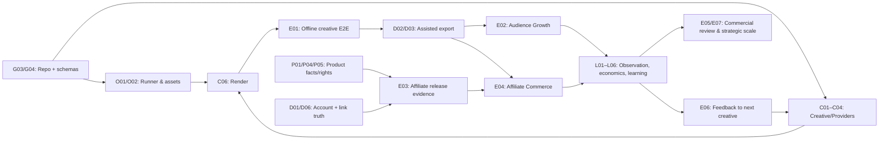

# AI COMMERCE — DETAILED WORK TREE v1.1 (CANONICAL PLAN)

**Adopted:** 2026-10-28 · **Mode:** HUMAN-APPROVED CANONICAL PLANNING · **Canonical repo:** `trung-via/ai-commerce` (`main`)  
**Source WBS v1.0 HEAD:** `13266240558aaf1ec3c80e0dfc3fe89911908002` · **Governance:** Human-adopted v0.3 · **Research reference:** Blueprint v1.2.  
**Status:** Canonicalized planning reference with Human approval; **no engineering implementation, executor dispatch, provider entitlement, spend or media publication** is implied.

> The WBS IDs below are **planning IDs**, not real GitHub issues, AIOS TASKs, executor admissions or an inherited task runtime. This design contains **63 planned work items** (20 P0 / 32 P1 / 11 P2) across 9 workstreams. P0/P1/P2 are recommended priorities, waivable or reorderable by Human.

## A. Definition, authority, design rules

**Work Tree** means a *Work Breakdown Structure (WBS)* and its proposed target code structure, not a set of pre-created `git worktree` directories. Human can switch, waive, reorder, expand or replace any internal task/gate at once. The source repo had governance/research and draft schemas at the recorded baseline; this v1.1 WBS is **Human-adopted planning**, not proof of implemented application.

Product intent: independent **Commerce Intelligence System**, starting from affiliate research and audience growth; optional own-brand strategy once economics warrant. **AI Commerce Brain** is the advisory architect; in-product **C02 Creative Reasoner** generates content. The **20 capabilities** in Blueprint are a long-term map, not 20 standalone agents or a mandatory task order.

Semantic truth owners: **Commerce Opportunity** (trend, audience, opportunity, portfolio, own-brand); **Product Intelligence** (product facts, offer, claims); **Media/Creative** (creative, assets, reasoner, experimental meaning); **Distribution** (account eligibility, publish/link, raw channel metrics); **Commerce Operations** (jobs/artifacts, generation costs, reconciled settlement). Campaign permissions/budget remain Human/delegate decisions. Shared policy/cross-cutting inputs do not create a sixth authority.

**Design freedom:** creative ideas, image/video generation, comedy/meme, animation, fiction, ads, rapid variants and render may proceed without product SKU, rights proof for an unused third-party asset, account proof, a fixed screenplay, 24-brief test, pilot or mandatory G0–G6. Claim verification, rights and account permission become important for the **specific external publish/commercial placement**. Human may waive internal QA/benchmark workflows, but that does not manufacture external rights or receipts.

## B. 8-branch work tree (overview)

```text
AI-COMMERCE / INDEPENDENT PROJECT
├── G / Foundation & Governance-aware Engineering
│   ├── G01–G02 Project state, ADR, semantic owners
│   ├── G03–G04 App skeleton, typed contracts
│   └── G05–G08 Provenance, tests, provider abstractions, isolation
├── EF / Engineering Flow (independent project tooling)
│   ├── EF01 Selective Extraction + Dual Executor Working Core
│   └── EF02 Independent Remote Wake + Feedback/Optional Native Continuation
├── O / Commerce Operations
│   ├── O01–O04 Job, runner, assets, bounded diagnostics
│   └── O05–O07 Cost, retry/idempotency, reports
├── M / Commerce Opportunity Intelligence
│   ├── M01–M05 Trend, audience, niche, campaign bridge
│   └── M06–M07 Portfolio decisions, own-brand support
├── P / Product Intelligence
│   ├── P01–P04 Sources, identity, claims/offers
│   └── P05–P07 Asset rights, product evidence, freshness
├── C / Media & Creative Intelligence
│   ├── C01–C03 Freeform brief, C02 Reasoner, scripts/prompts
│   ├── C04–C07 Asset generation, audio, render, batch
│   └── C08–C10 Technical/claim checks, learn-back
├── D / Distribution Intelligence
│   ├── D01–D03 Account capability, platform package, assisted publish
│   └── D04–D08 Receipts, reconciliation, links, API, channels
├── L / Measurement, Commerce Economics & Learning
│   ├── L01–L03 Metric definitions, import, audience reporting
│   └── L04–L07 Attribution, settlement, learning, decisions
└── E / Cross-domain vertical E2E loops
    ├── E01 Creative only (first runnable outcome)
    ├── E02 Audience Growth
    ├── E03–E05 Affiliate evidence, affiliate loop, economics
    └── E06–E07 Learning feedback, scale / own-brand
```

## C. Item-level tree (deliverable, acceptance, dependency)

**Legend:** P0 = first executable foundation and offline creative; P1 = expanded intelligence, assisted distribution and truthful observation; P2 = automation/scale/own-brand options. The priority is an *advisory sequence*, not a mandatory approval gate. Dep = technical/data prerequisite for the stated artifact; for example, C01/C02 are not blocked by account eligibility D01 or product truth P04.

### 00 · Chủ quyền dự án & kiến trúc nền

**Semantic owner:** Foundation.

| WBS | Work item & concrete output | Observable acceptance | Dep | Prio |
|---|---|---|---|---|
| `G01` | **Đăng ký trạng thái dự án** — Tạo living project-state, decision log và danh sách điều chưa chứng minh; liên kết Governance/Blueprint. | Đối chiếu chính xác repo main; không nâng research thành deployed. | `—` | P0 |
| `G02` | **ADR & semantic owner** — Tạo ADR template ngắn, owner registry dựa K-06, conventions/version. | Mỗi miền có một owner truth và biết ai được cập nhật. | `G01` | P0 |
| `G03` | **Repository application skeleton** — Thiết lập src, tests, docs/engineering, examples, entrypoint CLI, pyproject; công nghệ là đề xuất. | Clean install và hello-world CLI chạy trong repo độc lập. | `G01` | P0 |
| `G04` | **Schema package** — Nạp schema repo và bổ sung các bản ghi cần dùng: Brief, MediaArtifact, SourceSnapshot, JobResult, EvidenceRef. | Parse/validate được valid và invalid fixtures; thiếu field phải phân loại rõ. | `G02,G03` | P0 |
| `G05` | **Provenance & artifact identity** — Chuẩn hóa record ID, raw source ref, digest, generated media hash, timestamp, version. | Có thể truy media về input/manifest; thay input không silently reuse output. | `G04` | P0 |
| `G06` | **Targeted verification workflow** — Thiết lập test subset nhanh và CI tùy chọn cho từng module, lint/format. | Một command chạy unit/negative targeted tests, không cần full suite bắt buộc. | `G03` | P0 |
| `G07` | **Provider-neutral adapter contract** — Định nghĩa model/media/source adapters, capability, cost estimate, failures và fallback thủ công. | Mock provider pass; provider lỗi được phân loại chứ không bịa kết quả. | `G04` | P0 |
| `G08` | **Cross-project isolation & explicit component adoption** — Không kế thừa ngầm AIOS/Python Agent; selective extraction phải pin source/ref, provenance, quyền sử dụng, dependency/rollback. | Không import AIOS Runtime, `.ai` lifecycle, shared secrets hoặc dispatch; được phép trích component theo Human decision riêng. | `G03` | P0 |

### EF · AI Commerce Engineering Flow — project tooling (khác Product Commerce Operations)

**Semantic owner:** Engineering Foundation. **Human decision 2026-10-28:** selective extraction from pinned AIOS source; EF independent within `trung-via/ai-commerce`; dual executor Codex/Antigravity available by **manual WorkItem selection** (RECOMMEND can advise; AUTO not authorized by this plan).

| WBS | Work item & concrete output | Observable acceptance | Dep | Prio |
|---|---|---|---|---|
| `EF01` | **Selective Extraction + Dual Executor Working Core** — Project-owned WorkItem binding, executor profile, Codex/Antigravity CLI adapters, scoped verify, diagnostics, Git result, usage observations; no AIOS Task/Run/Kernel. | A real scoped code change with **each** selected executor is observed/verified in an independent AI Commerce workspace; profile/model/effort exact; failures and unknown remain honest; no implicit AIOS imports/credentials. | `G03,G06,G08` | P0 |
| `EF02` | **Independent Remote Wake + Feedback & Optional Native Continuation** — GitHub/Windows trigger, dispatch identity, results, failure feedback, authorized repair; app-server multi-turn when genuinely proven. | Remote work and its attempt-bound result can be traced without AIOS Runtime; CLI repair attempt is not mislabeled native continuation; remote UNKNOWN is not success. | `EF01` | P0 |

**EF-01 boundaries:** The source-snapshot reference for selective extraction is `trung-via/AIOS-renew@cbefb92612f24b55417165736c63753fc560d403`; this is provenance, not dependency or proof of compatibility. Candidate sources: `execution_profile.py`, `codex_adapter.py`, `antigravity_adapter.py`, `native_execution_policy.py`, selected `run_observation.py` primitives. **ADAPT**, do not copy entire `dispatcher.py`/Runtime or its historical hard defaults. Project-local external-component adoption records are required if code is actually transplanted, recording license/rights uncertainty and rollback.

**Token and fallback:** Record observed input/output/cached usage when a provider actually exposes it, otherwise `UNKNOWN`. Token totals from different providers do not by themselves prove equal costs or remaining quota. Switching executor is a **new attempt** and requires explicit policy/authorization; no blind retry of unresolved side-effects.

**Critical sequencing:** `A01` establishes `G03/G06/G08`; `EF01` and `A02` can proceed in parallel. `EF02` follows `EF01` but **does not gate** `A03–A06`, `C02` or `E01`. `M0` marks core foundation; optional remote milestone `M0-R` tracks EF02 separately. Engineering EF executes software changes; `O01–O07` orchestrate Commerce Product jobs and media production.

### 10 · Commerce Operations & execution core

**Semantic owner:** Commerce Operations.

| WBS | Work item & concrete output | Observable acceptance | Dep | Prio |
|---|---|---|---|---|
| `O01` | **Job manifest & run state** — Thiết kế job id, stage, input hash, output artifacts, cost, attempts, evidence refs. | Resume cùng job không mất trạng thái và không trộn kết quả job khác. | `G04,G05` | P0 |
| `O02` | **Single-worker local runner** — CLI trigger source/creative/render/export jobs; hỗ trợ dry-run. | Chạy một job mock E2E cục bộ với log và kết quả deterministic theo input cố định. | `O01,G07` | P0 |
| `O03` | **Artifact registry & custody** — Quản lý binary ảnh/video/âm thanh, thumbnails, script; version và storage root. | Phát hiện mất asset, không overwrite output đã được chốt mà không đổi version. | `G05,O01` | P0 |
| `O04` | **Bounded failure diagnostics** — Chuẩn error_code, stage, trace/log refs, retry_safety, last_state. | Failure trả ngữ cảnh đủ sửa; timeout không tự được xem là success. | `O02` | P0 |
| `O05` | **CostLedger for generation** — Log charged/estimated/pending cost, model, provider, token/duration, usable asset. | Tách estimated với charged; không tự retry lệnh mất kết nối có thể tính phí. | `O01,G07` | P1 |
| `O06` | **Retry/idempotency utility** — Khóa intent/attempt, de-dup và reconcile trước side effect nguy hiểm. | Một key không tạo hai publication/charge; unknown vẫn unknown. | `O04,O05` | P1 |
| `O07` | **Operational status report** — CLI summary job, artifact, stage, error và next-action theo dependency. | Report không gộp render, publish, click, order, settlement thành PASS chung. | `O04` | P1 |

### 20 · Commerce Opportunity Intelligence

**Semantic owner:** Commerce Opportunity.

| WBS | Work item & concrete output | Observable acceptance | Dep | Prio |
|---|---|---|---|---|
| `M01` | **Trend intake** — Import signal thủ công/hợp lệ kèm nguồn, locale, timestamp, metadata. | Một quan sát được giữ là snapshot, chưa gọi là growth trend. | `G04` | P1 |
| `M02` | **Trend tracking & hypotheses** — Gom nhiều mốc, distinguish format trend vs topic, freshness, counterexamples. | Thiếu lịch sử báo INSUFFICIENT_HISTORY; không phán viral chắc chắn. | `M01` | P1 |
| `M03` | **Audience insight registry** — Lưu persona/jobs-to-be-done, friction, content context, quan sát vs suy luận. | Insight truy được nguồn, phản ví dụ; không thu thập PII quá phạm vi. | `M01` | P1 |
| `M04` | **Niche & opportunity proposals** — Kết hợp trend, audience, alternatives, offer evidence, economics chưa chắc. | Trả danh sách giả thuyết có uncertainty, không tự chọn chi tiền. | `M02,M03` | P1 |
| `M05` | **Opportunity-to-campaign bridge** — Đưa rationale và bối cảnh sang ContentBrief; cho phép Human đi thẳng creative. | Brief có hoặc không có product_ref; không khóa sáng tác khi thiếu M04. | `M03,C01` | P1 |
| `M06` | **Portfolio recommendation (L04)** — Tổng hợp performance và chi phí để đề xuất keep/change/stop. | Khuyến nghị có provenance; không tự thay ngân sách hoặc chiến dịch. | `L06,M04` | P2 |
| `M07` | **Own-brand brief (B01)** — Demand signal, differentiated offer, COGS/MOQ, logistics, capital/downside. | Tạo brief go/no-go; không tự đặt hàng hoặc tuyên bố demand đã chứng minh. | `M06,L05` | P2 |

### 30 · Product Intelligence

**Semantic owner:** Product Intelligence.

| WBS | Work item & concrete output | Observable acceptance | Dep | Prio |
|---|---|---|---|---|
| `P01` | **Listing snapshot manual ingest** — Import sản phẩm/offer từ một URL hoặc tệp do Human cung cấp. | Lưu listing identity, variant, price observed_at, raw evidence; không auto auth. | `G04` | P1 |
| `P02` | **Authorized product source adapters** — Mở rộng feed/API/approved extraction theo provider-specific rights. | Nguồn không có quyền trả NOT_AUTHORIZED/UNKNOWN; không lách TOS. | `P01,G07` | P2 |
| `P03` | **Canonical identity & variants** — Tách product_id, listing_id, seller_id, variants, source revisions. | Hai variants không bị nhập nhầm; conflict có record rõ. | `P01` | P1 |
| `P04` | **Facts, claims and offer profile (M05)** — Phân loại verified, seller-asserted, assumption, illustrative; giá/hoa hồng có expiry. | Không nâng seller assertion thành verified; stale offer có cảnh báo. | `P03,G05` | P1 |
| `P05` | **Asset rights manifest** — Record source/license/rightsholder, phạm vi commercial, AI/synthetic origin. | Không mô tả license UNKNOWN như GRANTED khi phát hành. | `P01,G05` | P1 |
| `P06` | **Product fit handoff** — Trình bày facts, alternatives, uncertainties cho Commerce Opportunity/Creative. | Không tự phê duyệt kênh, budget hoặc quyết định product cuối. | `P04` | P1 |
| `P07` | **Source freshness and revocation** — Kiểm stale facts, expired offers, asset/reuse restrictions. | Thay đổi quyền tạo affected-assets list, không âm thầm publish lại. | `P04,P05` | P2 |

### 40 · Media & Creative Intelligence

**Semantic owner:** Media & Creative.

| WBS | Work item & concrete output | Observable acceptance | Dep | Prio |
|---|---|---|---|---|
| `C01` | **Freeform ContentBrief (C01)** — Brief linh hoạt nhận goal, aesthetic, audience, optional product/trend/CTA. | Không yêu cầu SKU, script, storyboard, KPI hay creative quota để tạo thử. | `G04` | P0 |
| `C02` | **Creative Reasoner v1 (C02)** — Prompt workflows: ideation, unusual concepts, humor, ads, mixed modes; optional rationale/test. | Sinh một hoặc nhiều concept tùy request; không bịa fact thành verified. | `C01,G07` | P0 |
| `C03` | **Script / prompt / scene representation (C03)** — Output freeform hoặc structured script/scene plan với editable versions. | Có thể đi thẳng từ prompt -> media; storyboard không mandatory. | `C02` | P0 |
| `C04` | **Image/video provider adapter (C04)** — Adapter generate/import AI, animation, real footage, stock đúng quyền; lưu receipts. | Dummy + một provider selected chạy; cost/status/asset metadata hiện rõ. | `G07,O03` | P0 |
| `C05` | **Voice/music/subtitle tools** — TTS, existing audio, silence, transcript/subtitle optional. | Video không lời chạy được; tiếng Việt không mất dấu/đồng bộ sai. | `C04` | P1 |
| `C06` | **Render & compose video (C05)** — Assemble optional scenes/audio/captions, crop, encode MP4, thumbnail, preview. | Render output playable; metadata ratio/resolution/duration/cost/log/hash. | `C03,C04,O02` | P0 |
| `C07` | **Variants & batch factory** — Tạo biến thể tự do hoặc controlled tiny changes; version assets/script. | Không overwrite master; đo được chi phí/usable output. | `C06,O03` | P1 |
| `C08` | **Technical media inspection (C06)** — Kiểm lỗi codec, black frames, timing, audio, artifact integrity; optional review. | Lỗi kỹ thuật trả code/preview; không phán xét gu thẩm mỹ mặc định. | `C06` | P1 |
| `C09` | **Claim/rights release review** — Xem factual claims/rights/disclosure khi chuẩn bị commercial/public release. | Đánh dấu UNKNOWN/NEEDS_REVIEW cụ thể; fiction không bị coi factual by default. | `C08,P04,P05` | P1 |
| `C10` | **Creative learn-back integration** — Cho Reasoner truy lessons có uncertainty, version, counterexample. | Chỉ dùng signal có provenance; không tự hứa viral hoặc lift. | `C02,L06` | P2 |

### 50 · Distribution Intelligence

**Semantic owner:** Distribution.

| WBS | Work item & concrete output | Observable acceptance | Dep | Prio |
|---|---|---|---|---|
| `D01` | **Platform/account capability registry** — Surface/account/market/app/scopes/policy checked_at, status/expiry. | UNKNOWN khác ALLOWED; không thừa kế account Python Agent. | `G04` | P1 |
| `D02` | **Platform output adapter (D01)** — Tạo video file, title, hashtags, caption, thumbnail, optional disclosure/package. | Định dạng đủ để Human upload trên một kênh mục tiêu; không tự gắn link sai. | `C06,D01` | P1 |
| `D03` | **Assisted/manual publishing handoff (D02)** — Export package + checklist per actual account, nơi điền post receipt. | Không có quyền API vẫn có đường thao tác thủ công; chưa receipt là not confirmed. | `D02` | P1 |
| `D04` | **Publication receipt & status** — Store intent, content digest, URL/post ID, submitted vs confirmed/public/visibility. | SUBMITTED ≠ PUBLISHED_CONFIRMED ≠ PUBLIC; state có evidence. | `D03,O01` | P1 |
| `D05` | **Unknown/reconciliation and no-dupe** — Đối chiếu timeout, revoked permission, duplicate callback, manual ambiguity. | Không retry publish mù khi outcome unknown, không tạo duplicate post. | `D04,O06` | P1 |
| `D06` | **Affiliate link and placement (D03)** — Verify account×surface×product×link availability/disclosure; link lifecycle. | Product link không được ngầm xem active khi thiếu proof. | `D01,P04` | P1 |
| `D07` | **Official direct post adapter** — Tích hợp API theo app/account entitlement và phạm vi Human ủy quyền. | Chỉ thực hiện ở account/surface có quyền; lưu provider receipt, idempotency. | `D04,D05` | P2 |
| `D08` | **Multi-platform extension** — Version adapter theo mỗi channel và so sánh visibility/metric definitions. | Không sao chép khả năng/kết quả PASS giữa các platform. | `D02,D07` | P2 |

### 60 · Measurement, Economics & Learning

**Semantic owner:** Distribution/Operations/Creative split.

| WBS | Work item & concrete output | Observable acceptance | Dep | Prio |
|---|---|---|---|---|
| `L01` | **MeasurementPlan & metric dictionary** — Metric name/version/window/denominator/timezone/account/cohort/status. | Không nhầm NOT_AVAILABLE=0; có provenance và metric version. | `G04` | P1 |
| `L02` | **Analytics importer (L01)** — Manual CSV/export trước; API nếu account cho phép; lưu raw + normalized. | Input thiếu column báo lỗi bounded; raw bytes không bị sửa. | `L01,D04` | P1 |
| `L03` | **Audience performance report** — Reach/watch/relevance/returning viewers theo dataset thực; trend comparison. | KPI đúng denominator và window; không tuyên bố lift nếu không có data. | `L02` | P1 |
| `L04` | **Affiliate attribution tiers** — Thiết lập A/B/C/D, click/order ID mapping theo capability thật. | C/D không trở thành per-video profit đã xác minh. | `L02,D06` | P1 |
| `L05` | **Settlement & contribution reconciliation (L02)** — Order created, refunded, adjusted, settled, ledger costs và attribution scope. | Pending không phải 0/settled; contribution có scope và tiền tệ. | `L04,O05` | P1 |
| `L06` | **Learning registry (L03)** — Hypothesis, context, creative version, outcome, confounder, inconclusive cases. | Không suy nguyên nhân từ correlation; lưu negative evidence. | `C01,L03` | P1 |
| `L07` | **Decision dashboard** — Hiển thị media yield, publication state, audience outcomes, commerce evidence riêng. | Không gộp tất cả thành SUCCESS; nguồn và trạng thái hiển thị. | `O07,L06` | P2 |

### 70 · End-to-end product slices

**Semantic owner:** Cross-domain.

| WBS | Work item & concrete output | Observable acceptance | Dep | Prio |
|---|---|---|---|---|
| `E01` | **Offline creative E2E** — Brief hoặc prompt -> AI/real asset -> rendered MP4 -> manifest/log. | Một video thực dùng được, replayable; không cần SKU/publish proof. | `C01,C02,C04,C06,O02` | P0 |
| `E02` | **Audience Growth vertical slice** — Creative E2E -> platform export -> assisted publish -> receipt -> audience import. | Nếu user đăng thật có receipt đúng account và observation; nếu chưa thì ghi PARTIAL, không ngăn offline. | `E01,D03,D04,L02` | P1 |
| `E03` | **Affiliate release evidence pack** — Một product snapshot/claim/rights + verified account×surface/link; package for publication. | Missing entitlement dẫn tới manual/hold đúng action, vẫn render creative được. | `P04,P05,D01,D06,C09` | P1 |
| `E04` | **Affiliate Commerce vertical slice** — Product evidence -> creative -> media -> assisted/allowed publish -> link observation. | Public/link/order statuses độc lập; không tuyên bố revenue khi thiếu. | `E01,E03,D04,L04` | P1 |
| `E05` | **Commercial evidence review** — CostLedger + actual orders/refunds/settled export + attribution tier. | Verdict VALIDATED_FOR_SCOPE/PROMISING/INCONCLUSIVE/NEGATIVE theo scope, không suy ROI. | `E04,L05` | P2 |
| `E06` | **Feedback-to-next-creative loop** — L06 lessons trở thành next campaign prompts/variants, optional tests. | Có before/after với cùng metric definitions; lessons có uncertainty. | `L06,C10` | P2 |
| `E07` | **Scale and own-brand option** — Human decision memo for provider cost scaling, channel growth, inventory/brand. | Không tự tăng ngân sách, mua hàng hay mở account. | `E05,M07` | P2 |

## D. Dependency graph — technical dependencies, NOT universal governance gates



**Parallel engineering enablement:** `G03/G06/G08 → EF01 → EF02 (remote optional)`. EF02 is not a requirement to start offline creative E01.

**Critical path A, first usable output:** `G03 → G04 → O01/O02/O03 → C01 → C02 → C04 → C06 → E01`. Can reduce to a prompt-to-video prototype if Human wants the fastest start, preserving only the required trace/feedback.  
**Path B, audience operations:** `E01 → D01 → D02 → D03 → D04 → L01 → L02 → E02`. Publication is assisted/manual until external entitlement is confirmed.  
**Path C, affiliate commercial observation:** `P01 → P03 → P04/P05`, alongside `D01 → D06`, joining at `E03 → E04 → L04 → L05 → E05`. Publishing and linking require externally real rights and account eligibility.  
**Path D, intelligence enhancement:** `M01/M03 → M04 → C01/C02`, optionally informed by `L06`, creating learning rather than a fixed creative formula.

## E. Suggested implementation cuts / work packets

| Cut | Outcome Human can inspect | Suggested WBS candidates | Explicitly NOT required first |
|---|---|---|---|
| **S0 — Working skeleton** | Fresh standalone code skeleton; typed manifests; dry-run job; evidence files and quick tests | `G01–G08`, `EF01`, optional parallel `EF02`, `O01–O04` | DB, Kubernetes, full AIOS Runtime lifecycle |
| **S1 — Creative Factory** | Prompt/brief -> assets -> MP4; preview; version/cost/log | `C01–C04`, `C06`, `E01`; optional `C05,C07,C08` | Product listing, sales account, public publish, benchmarks |
| **S2 — Intelligence inputs** | Trend/audience signals and one product facts pack feed the creative tools | `M01–M05`, `P01,P03–P06` | Automated scraping, ranker automation, commercial claims |
| **S3 — Distribution** | One channel export, assisted post record, unknown reconciliation | `D01–D05`, `E02`; optional `D06,E03,E04` where entitled | API Direct Post, multiple platforms |
| **S4 — Truthful economics & learning** | Imported observations, tiered attribution, cost/settlement and feedback | `L01–L06`, `O05–O07`, `E05,E06` | Sales/ROI claim without actual source |
| **S5 — Scaling extensions** | Batch, adapters, dashboards, portfolio advice, brand decision briefs | `C07,C10,D07,D08,L07,M06,M07,E07` | Mandatory scale or inventory purchase |

**Overlap is intentional:** work packets are negotiable scopes; Human can choose any branch, run concurrent development, or prioritize creative first. No fixed day/effort promise. Short verification is scoped per module/action, not a forced full-suite regression for every update.

## F. Minimal contracts / code targets

| Record or interface | Truth-owning module | Source & consumer | Negative path to model |
|---|---|---|---|
| `SourceSnapshot / TrendCandidate / AudienceInsight` | Commerce Opportunity / Product as appropriate | User-authorized signal → Mxx, Creative | One snapshot ≠ verified trend, stale evidence |
| `ProductEvidenceProfile / ClaimEvidence / AssetRightsRecord` | Product Intelligence / designated asset-right owner | Listing & rights source → Cxx, Dxx | Seller claim ≠ verified, expired license |
| `ContentBrief / CreativeHypothesis / MediaArtifact` | Media & Creative | Human/media sources → generation, rendering | Fiction accepted, unverified factual assertions flagged for release |
| `JobManifest / ArtifactRef / CostLedger` | Commerce Operations | All jobs → replay, charge/loss visibility | Timeout, missing asset, double charge, stale digest |
| `CommercialAccessProfile / PublicationRecord / LinkRecord` | Distribution | Actual account/surface → publication | Unknown eligibility, private-only, duplicate post, revoked link |
| `MeasurementPlan / PerformanceObservation` | Distribution for raw platform metrics | CSV/API/manual → attribution, learning | Missing ≠ 0, metric definition changed |
| `CommerceOutcome / SettlementReconciliation` | Commerce Operations | Actual affiliate exports, adjustments → economics | Order-created ≠ settled, attribution gap |
| `LearningUpdate / OwnBrandDecisionBrief` | Media/Creative for experiments; Opportunity for brand | Observations → decisions | Correlation ≠ causation, recommendation ≠ authorization |

## G. Suggested repository directory tree

This is a **target layout**, not a claim that the directories exist in GitHub. Start by adding only the files needed by the chosen cut; do not create empty 20-agent services.

```text
ai-commerce/
├── MANIFESTO.md                  # existing Human-adopted governance
├── CONSTITUTION.md               # existing
├── PROJECT_CONTRACT.md           # existing
├── contracts/                    # existing draft schemas; extend as needed
├── docs/
│   ├── blueprint/                # existing v1.2 reference
│   ├── governance/               # existing adoption record
│   ├── research/                 # existing RA/reference
│   ├── architecture/             # proposed ADRs & semantic boundaries
│   ├── roadmap/                  # proposed WBS, decision register, status
│   └── operations/               # proposed runbook/error codes
├── src/ai_commerce/
│   ├── app/                      # CLI entrypoint, use cases / composition
│   ├── core/                     # schemas, evidence/provenance, permissions
│   ├── opportunity/              # M01/M02/M03 + M06/M07
│   ├── product/                  # M04/M05 => WBS P*
│   ├── creative/                 # C01...C06, L03 learning meaning
│   ├── distribution/             # D01/D02/D03, raw channel metrics
│   ├── operations/               # O01, assets, job state, cost, settlement
│   └── integrations/             # providers/owned-account adapters
├── tests/
│   ├── unit/                     # fast module contracts
│   ├── integration/              # file/provider adapter mock
│   └── fixtures/                 # redacted inputs + negative paths
├── config/                       # non-secret settings
├── scripts/                      # setup / diagnostics, optional
└── .github/workflows/            # minimal targeted CI when chosen
```

**Persistent data:** define configurable local artifact and state directories outside the tracked code (e.g. `.local/` ignored by Git), versioned source metadata and immutable media manifests; no production credential in repository. Choose a database/queue or UI later if evidence shows they are worth the complexity; not forbidden.

## H. Planned first implementation batch (no tasks/issues dispatched)

| Step | Work IDs | Requested observable deliverable | Targeted checks |
|---|---|---|---|
| 1 | `G03,G04,G05,G06,G08,EF01` | Importable local app + 1 CLI command + manifest schema | clean install, good/bad schema fixtures, isolation |
| 2 | `G07,O01,O02,O03,O04` | Local worker can run a mock asset job and persist receipts | success, missing asset, interrupted attempt |
| 3 | `C01,C02,C03` | Brief/prompt -> editable concept/script with optional scenes | product_ref null, humor/fiction, ambiguous claims |
| 4 | `C04,C06` | Provider-adapter media -> reproducible playable MP4 | provider fail, wrong codec, digest mismatch |
| 5 | `E01` | One end-to-end creative video with complete artifact trail | rerun/reopen result, no false live-publish assertion |
| 6 | `D01,D02,D03,D04,L01,L02` | Human-assisted export, honest publication/measurement record | private vs public, missing report, account mismatch |

**Recommended first demonstrable capability:** `E01` — creative video generation that works even while channel/account/product evidence remains unconfirmed. If Human's immediate goal is affiliate operations instead, reprioritize `P01,P03,P04,P05,D01,D06,E03` before any publishing side effect.

## I. Completion semantics and status model

For each WBS item, maintain `PROPOSED | ACCEPTED_FOR_WORK | IMPLEMENTED | BUILD_VERIFIED_FOR_SCOPE | LIVE_CONFIRMED` (the last only when relevant). Dependencies express engineering needs; they are not automatic vetoes on Human changes. Each item can be split into a `WorkItem.v0.3` record (objective, in/out, deliverable, acceptance, evidence, owner, status) only when the implementation plan is accepted. No automatic TASK numbering, dispatch or cost; EF01/EF02 are also planning IDs, not initiated executor attempts.

Project claims should remain distinct:
- **Creative render:** playable file + artifact receipt; not evidence of a live post.
- **Publication:** submitted / published confirmed / visibility public / affiliate link active require distinct evidence.
- **Orders:** created / paid / returned / settled require appropriate real export and attribution tier.
- **Costs and revenue:** estimated ≠ charged ≠ settled; `NOT_AVAILABLE` is not zero.

## J. Decision & evidence register (not blockers for offline creative)

| Decision / unknown | Default in proposed WBS | Moment when it matters |
|---|---|---|
| First niche, first affiliate SKU, channel | OPEN; allow generic/content-only examples | Selecting live campaign and account-specific release |
| Creative provider/model and paid budget | OPEN; mock provider supported initially | Real API spend; choose cost/risk envelope |
| Real footage, seller media, music rights | OPEN; generated/test-owned assets initially | External commercial distribution using affected assets |
| Platform app/account/surface permissions | UNKNOWN until actual entitlement evidence | Live publish or shoppable link |
| Manual versus direct publishing | Assisted/manual is an implementation option | First live post; Human can change strategy |
| Analytics exports and settlement | UNKNOWN; CSV/fixture import can be built | Claiming account metrics/profit |
| Architecture tech stack, DB/queue/UI | Python modular app **candidate**, not law | Engineering choice with ADR and acceptance |
| Scale, own-brand capital, inventory | OPEN; optional recommendation only | Irreversible spend/stock decisions |

## K. Canonical source traceability

- `README.md`, `docs/governance/HUMAN_ADOPTION_2026-10-27.md` — verified independent repository and Governance v0.3 adoption.
- `MANIFESTO.md` M-01…M-14 — business value, dual cycles and unrestricted creative media.
- `CONSTITUTION.md` C-01/C-02/C-03/C-04/C-15/C-19 — Human override, project independence, Brain vs C02, evidence.
- `PROJECT_CONTRACT.md` K-04…K-18/K-21 — owners, optional WPs, creative freedom, external action/observations and work-item rules.
- `docs/blueprint/BLUEPRINT_V1_2_FULL_TEXT.md` §§6–7, 15, 28–38 — 20-capability map, interfaces, source/rights, operation, metrics, phased slices.

**Current planning state (2026-10-28):** This Work Tree v1.1 and Roadmap A are Human-approved plans in GitHub. No GitHub Issues, engineering RUN, executor dispatch, implementation verification, live publishing, or commercial outcomes have been created by this planning change. WorkItem statuses remain PROPOSED for execution until independently authorized/observed.
## L. Canonical planning alignment

- Companion source: [`WORK_TREE_V1_1.json`](WORK_TREE_V1_1.json) — 63 WBS items with machine-readable dependencies.
- Selected six-phase plan: [`ROADMAP_A_CREATIVE_FIRST_V1_0.md`](ROADMAP_A_CREATIVE_FIRST_V1_0.md) and [JSON](ROADMAP_A_CREATIVE_FIRST_V1_0.json) — A01–A18, M0–M6, with EF-01/EF-02 in Phase 0.
- Human decision: [`HUMAN_DECISION_2026-10-28_ENGINEERING_FLOW.md`](../governance/HUMAN_DECISION_2026-10-28_ENGINEERING_FLOW.md).

## A01 delivery observation — 2026-10-28

Human requested execution of `A01-BOOTSTRAP-001`. G01/G02/G03/G06/G08 have package skeleton, targeted tests, project-state/ADR/semantic-owner records and isolation observations. Status `BUILD_VERIFIED_FOR_SCOPE` is **local Python bootstrap only**, not Windows live verification, executor invocation or product readiness.

[WorkItem](../../work_items/A01-BOOTSTRAP-001.json) · [Evidence](../engineering/A01_IMPLEMENTATION_REPORT.md). A02, EF01, EF02 are not implemented; M0 is not achieved.

## A02 delivery observation — 2026-10-28

Human requested A02 implementation. `G04/G05/G07` are `BUILD_VERIFIED_FOR_SCOPE` **on the Linux local environment**: five installable JSON Schema 2020-12 files, provenance/content hashes, a provider-neutral Product adapter protocol and a TEST-ONLY mock textual artifact with manifest/receipt. Targeted regression: 31 passed (11 existing A01 + 20 A02). It does **not** establish a live video/image provider, Windows compatibility, EF01/EF02, publishing or paid model rights.

[WorkItem](../../work_items/A02-CONTRACTS-001.json) · [Evidence](../engineering/A02_IMPLEMENTATION_REPORT.md).
