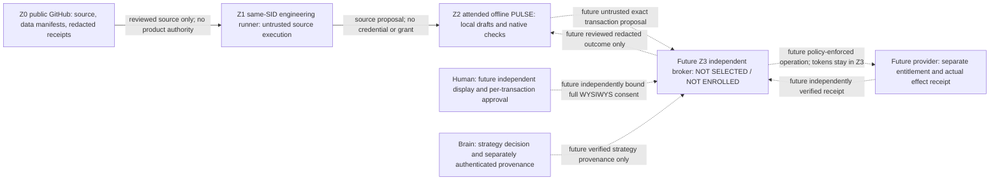

# B0-S.3a custody architecture v1

Status: **S3A_SOURCE_ONLY / S3B_LIVE_CUSTODY_UNKNOWN**. `PRIVATE_CUSTODY_VERIFIED`
remains **UNKNOWN**. Baseline: `7a4403014d72d203a111f87c0176ef500febd2b0`;
Human source authorization: 2026-11-05, “tiếp tục thực hiện B0-S.3”.
No live issuer, broker, vendor, device or service has been selected or enrolled.

The [PA2 roadmap B0-S G05/G08](../roadmap/ROADMAP_B_PA2_PRODUCTION_RUNTIME_V2_0.md)
and [ADR B001](../architecture/ADR_B001_BRAIN_LED_INDEPENDENT_RUNTIME.md) require
credential custody independent of the public engineering runner before live
effects. [S1 inventory](B0_S1_TRUST_ZONE_INVENTORY_V1.md),
[S2 protocol](B0_S2_AUTHORITY_PROTOCOL_V1.md), and the source-recorded
[research Issue #356](https://github.com/trung-via/ai-commerce/issues/356) are
context, not trust roots. No remote read or current external configuration
attestation was performed in this cut; primary references below are design
guidance carried forward from those authorities and the Human instruction.

## Decision matrix

| Option | Custody / authentication / transaction consent | Same-SID compromise and rollback | Operations burden | Decision / missing proof |
|---|---|---|---|---|
| A: attended ephemeral operation on the existing host | Short lifetime may reduce exposure; no independent same-SID isolation if code or bearer material is accessible to that SID. Attendance alone authenticates neither Brain nor complete transaction. | Malicious same-SID code may capture material or replace local journal/anchors. Closing a terminal does not revoke copied tokens. | Repeated setup, attendance, redaction and reconciliation; eliminate retention and independently revoke after each use. | Offline drafting remains available. This option does not establish private custody; no live ephemeral token use is authorized here. |
| B: off-host isolated broker with independently authenticated Human full WYSIWYS approval | Provider tokens remain in a separately controlled Z3. Broker enforces exact request, independent issuer and Human consent, rights, entitlement and spend at use time; no policy-bypassing bearer returns to Z1. | Must independently demonstrate host/admin separation, pinned enrollment root, monotonic epochs, durable replay/budget reservations, revoke/KILL and compromise recovery. Off-host location alone is insufficient. | Highest explicit setup: independent device/operator, recovery, patching, audit, budget reconciliation, receipt verification and availability. Failure must stop effects. | **Brain RECOMMENDATION**, conditional on future Human selection and real attestation. No vendor or device selected; no broker implemented. |
| C: passkey or hardware key ALONE | May authenticate an authenticator to a bound verifier. Does not hold or isolate provider tokens or independently display and approve the complete transaction. User verification is not independently verified full transaction consent. | Same-SID code may substitute the request/display or use an exposed provider bearer. Authenticator protection does not protect another process's secrets or replay register. | Device enrollment/recovery/revocation and verifier binding still needed; complete broker policy remains separate. | Insufficient alone. Possible future authentication component inside B after review, not an authorization shortcut. |
| D: Windows DPAPI / Credential Manager / local ACL / TPM ALONE | At-rest protection or nonexportable keys do not prove protection from an authorized same-SID caller or mediate complete provider transactions. | CryptProtectData normally follows Windows logon credentials; a same-logon caller may obtain plaintext or invoke allowed operations. A TPM key alone does not isolate provider tokens or independently enforce full consent. | Local recovery, backups, account security and root protection remain; same-SID tampering with policy/ledger is unresolved. | Insufficient alone; no custody inference from “DPAPI protected”, ACL or TPM labels. |
| E: always-on local service under the same Windows SID | Different process, scheduler task or runner directory does not create an independent authority/credential boundary. | Persistent compromise, process access, local policy replacement and journal rollback remain possible. “Installed” or “Online” is not isolation evidence. | Continuous patching, monitoring, restart safety, reconciliation and kill/recovery; greater exposure duration. | Deferred; not isolated as described and no service installation authorized. |

The source model deliberately has no cryptographic signer, enrolled public root,
HMAC test root, real token, broker process, transport or external permission API.
Canonical identity and coherent synthetic claims cannot satisfy option B.

## Actors, data and capabilities

Dashed edges are obligations, not implemented routes. Missing or unreachable Z3
means **HOLD**, never direct provider fallback. Z1 holds no bearer credential that
can bypass broker policy. A future broker must perform the authorized operation
itself or enforce an independently demonstrated equally restrictive provider
capability; handing a normal provider token to the runner violates this design.

| Actor/zone | Permitted source role | Data ceiling / prohibited capability |
|---|---|---|
| Z0 repository, Issues, PRs, CI | Proposed code, schema-free draft design, synthetic tests, finite redacted receipts | No keys/tokens/cookies/customer data/private paths; source PASS and owner comments cannot authorize product effects. |
| Z1 EF01/EF02 engineering runner | Build and locally test exact authorized source; EF02 alone publishes after its own proof | Treat all executed public code as untrusted for private custody. No provider tokens, issuer private keys, broker administrator/recovery material or bearer bypass. Executor has no candidate Git write authority. |
| Z2 offline PULSE | Existing B0.1–B0.4 attended offline behavior, native locks/QA/rights/recovery | No new policy wiring or live permission. Its local journal is coordination evidence, not independent anti-rollback custody. |
| Brain | Decide strategy, review directive/version/final media/action | Current chat and source review are not independently signed strategy provenance; Brain does not supply provider entitlement, asset rights or spend consent. |
| Human | Source authorization now; separate live device/broker selection and exact transaction consent later | No universal delegation inferred from this chat, GitHub owner status or HostOps Personal WRITE. |
| Future Z3 verifier | Independently authenticate issuer/root and transaction consent; mediate token use, revoke and reserve | Root admission, replay and budget state must be outside Z1's SID/admin/worktree control. No such verifier exists in this source model. |
| Future independent auditor | Verify actual isolation, enrollment, rollback, revocation and provider receipt evidence | Must be independent of the engineering claimant; cannot accept a submitted `verified=true`, configuration or fixture as attestation. |
| Provider and semantic owners | Independently establish actual API/account/surface rights and observations | PULSE stores reviewed refs/digests, never a duplicate commerce truth ledger. |

## Independent permission layers

| Layer | Exact future evidence | Never interchangeable with |
|---|---|---|
| Issuer identity and private custody | Out-of-band admitted root/key ID, proof of possession, bounded audience/scope, current epoch and revocation channel | Repo JSON, GitHub ownership, source tests, a signature label, a key fingerprint or a hosted CI PASS |
| Brain strategy | Independently authenticated current-chat decision binding journey, exact source/directive version/digest, final media and action | Human release, private-custody attestation or copied BrainDecision/source PASS |
| Human transaction release | Fresh independently authenticated full WYSIWYS consent to one exact canonical transaction | WebAuthn user verification alone, Brain approval, HostOps WRITE or broad standing permission |
| Provider entitlement | Independently checked actual provider/account/surface/action eligibility at use time | A configured adapter, Human consent or a self-asserted provider label |
| Asset/data rights | Fresh action-specific media/voice/music/input/claim/privacy evidence, relevant owner refs/digests | Provider account access, synthetic fixtures or a previous unrelated asset approval |
| Spend | Separate currency, maximum exposure, exact spend grant and atomic independent reservation/reconciliation | GO_PUBLISH, a proposed strategy budget, zero previous cost or an estimated ledger total |
| External outcome | Authenticated provider observation matching original key, target, result and actual currency/cost | Local checksum, supplied receipt, a cancelled label or successful transport response alone |

The five existing semantic owners remain Commerce Opportunity, Product
Intelligence, Media & Creative, Distribution, and Commerce Operations. Engineering
builds source; PULSE coordinates refs; neither creates another source of truth.

## Evidence ladder

| Claim | Observed source/config | Present evidence ceiling |
|---|---|---|
| Source boundary | Exact clean baseline and eight absent targets checked before editing; new modules pure and disconnected | Worktree observation and offline tests only; final candidate bytes require EF01 binding. |
| Existing S2 external gate | `security_policy.py` unconditionally holds recognized external actions | Preserved, unchanged source; never replaced by S3a. |
| Windows same-SID threat | [HostOps W1 phase2 source](../engineering/HOSTOPS_W1_PHASE2_SOURCE_HANDOFF.md) explicitly denies independent same-SID custody | Source threat model, not permission to invoke HostOps. |
| Runner topology | [Three-runner rollout source](../engineering/THREE_RUNNER_ROLLOUT_20261104.md) describes three registrations on one laptop/user | Configuration intent; not live runner identity, isolation, credentials or throughput proof. Twelve pytest workers are distinct from three runner instances. |
| Z2/native behavior | Existing owner tests, source pins, locks, leases, QA and recovery | Original failures, skipped native controls and UNKNOWN remain as reported; not live service proof. |
| Z3 custody, issuer and real revocation | No selected device/vendor, enrolled root or independent live attestation | **UNKNOWN / UNSUPPORTED**. No live transition can be established by source tests. |

## Compromise, rollback and operations

Treat Z1 compromise as a reason to distrust its proposed transaction, receipt,
display, key labels, clock, local journal and source approval. A future Z3 must
fail closed on missing policy/audience/epoch anchors, suspend new effects at
KILL, preserve original UNKNOWN exposure and independently revoke provider
sessions and issuer grants. Recovery requires out-of-band root/epoch verification,
independent receipt reconciliation and fresh exact transaction approval; replacing
the worktree or rebooting the laptop is insufficient.

Z3 needs a separately authorized operator, update/recovery policy, bounded
availability, durable replay and budget storage, redacted audit retention, tested
revocation latency and provider cancellation semantics. These impose ongoing
cost and operational responsibility. No availability failure may cause Z1/Z2 to
mint a new key, reuse consent, free an uncertain reservation or call a provider.
The [enrollment/revocation protocol](B0_S3_ENROLLMENT_REVOCATION_PROTOCOL_V1.md)
defines the future obligations and current unsupported transitions.

## Primary guidance and interpretation

These links are references, not implementation, certification, freshly fetched
evidence or a selected trust root. The same-SID conclusions are architecture
inferences under the stated threat model, reinforced by the existing HostOps
source; no live adversarial test was authorized.

- [GitHub self-hosted runner security](https://docs.github.com/en/actions/reference/security/secure-use#hardening-for-self-hosted-runners): informs distrust of public engineering execution for private production custody.
- [Microsoft CryptProtectData](https://learn.microsoft.com/en-us/windows/win32/api/dpapi/nf-dpapi-cryptprotectdata): normal user/logon binding does not establish an independent boundary against malicious same-logon callers.
- [NIST SP 800-207](https://csrc.nist.gov/pubs/sp/800/207/final): explicit per-resource policy informs the separate enforcement boundary.
- [NIST SP 800-63B-4](https://pages.nist.gov/800-63-4/sp800-63b.html): authenticator/verifier binding and replay/intent requirements inform future enrollment; no conformance claim.
- [OWASP Transaction Authorization](https://cheatsheetseries.owasp.org/cheatsheets/Transaction_Authorization_Cheat_Sheet.html): significant transaction data, independent confirmation and uniqueness inform full WYSIWYS.
- [WebAuthn assertion verification](https://www.w3.org/TR/webauthn-3/#sctn-verifying-assertion): verifier/challenge/origin binding is an authentication obligation. A UV result alone does not attest complete transaction display/consent or token isolation.
